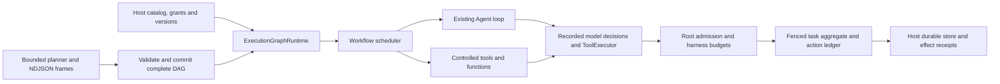

# Recoverable execution graphs

`ExecutionGraphRuntime` combines the existing Workflow scheduler, Agent loop and ToolExecutor with the core durable task protocol. A host supplies a versioned executable catalog. A static plan or an optional model planner selects catalog operations; proposals cannot supply code or grants.



## Public entry point

```ts
import { InMemoryDurableTaskStore } from "@agentium/core";
import { ExecutionGraphRuntime, type GraphToolBinding } from "@agentium/harness";
import { z } from "zod";

const input = z.object({ value: z.string() });
const echo: GraphToolBinding = {
  id: "echo", version: "1", kind: "tool", input, output: z.string(),
  recovery: "pure", // host attests this callback performs no external mutation
  tool: { name: "echo", description: "Return a value", parameters: input,
    execute: async (args) => String(args.value) },
};
const graph = new ExecutionGraphRuntime({
  store: new InMemoryDurableTaskStore(), // local fixture; capabilities.durable is false
  catalog: [echo],
  program: { id: "example", version: "1", plan: {
    schemaVersion: 1, revision: 1,
    nodes: [{ id: "result", binding: "echo", version: "1", args: { value: "hello" } }],
  } },
  limits: { maxConcurrentWork: 2, maxExpandedNodes: 100,
    maxWorkAttempts: 200, maxPlanRevisions: 10 },
  harness: { grants: { toolIds: ["echo"], modelRoles: ["main"] },
    budgets: { maxModelCalls: 10, maxToolCalls: 100, maxTokens: 20_000 } },
});
await graph.create({ id: "task", input: {}, identity: {
  tenantId: "verified-tenant", actorId: "verified-actor", sessionId: "session",
  runId: "run", rootRunId: "run",
}, deadline: Date.now() + 60_000 });
const result = await graph.run({ tenantId: "verified-tenant", taskId: "task" }, "worker");
// result.output === { result: "hello" }; result.task and result.graph retain evidence.
```

For persistence, supply `MongoDBDurableTaskStore` or another host adapter implementing durable atomic CAS and fencing, and set `requireDurable: true`. The host owns credentials, MongoDB lifecycle, authenticated tenant/actor admission and receipt retention. `JournaledDurableTaskStore`/`DurableRunRecords` can additionally retain sequenced host audit events; graph state remains authoritative. `inspect(key)` validates without writing or requiring a live lease. `cancel(key, reason)` requests persisted cancellation; active lease polling observes it. Completed tasks return retained output without another dispatch.

`GraphBinding` supports `tool`, `agent`, `graph` and bounded `repeat`. A controlled function is a catalog `ToolDef.execute`; it has the same schema, grants and recovery boundary as other tools. Agent bindings supply an existing `Agent` and an explicit list of approved catalog tool IDs. Agent output is `{ text, usage }`, validated by the binding's output schema. Nested graph output is a map of node IDs to owned JSON outputs. Repeat guards are versioned, pure host callbacks; their decisions and iteration plans persist before child work.

## Recovery and effects

Each task pins its manifest, catalog digest, program/binding versions, original input, policy revision, grants, budgets and absolute deadline. Plans are immutable revision records. Nodes have stable incarnation IDs, input/output digests and fenced attempt records. Completion persists before successor admission. Pending nodes can be claimed; an interrupted running node starts another attempt under a newer lease. Completed output is reused; failed/cancelled nodes remain terminal. Unknown external outcomes require reconciliation before execution resumes. A changed version, input, digest or stale fence fails before resumed effects.

The runtime copies plain configuration when constructed: static and nested plans, planner bounds, grants, budgets, limits and tool protection data. Later changes to the caller's objects do not change an admitted task. Descriptor checks run again at episode and dispatch boundaries. Opaque schemas, Agent/provider instances and callback behavior remain host bindings; their version must attest those implementations. Sandbox environment values contribute only hashes to catalog descriptors, so planner messages and stored descriptors contain no environment values.

Interrupted Agents restart from node entry. Complete recorded model responses are reused at the same request-bound positions; their original tool call IDs remain stable. Tool authorization runs again, while stable budget admission IDs avoid charging replay twice. Interrupted model reservations remain conservatively charged as unknown usage. Recovery does not replenish tokens, calls, root allowances or deadlines.

Durable tools require either `recovery: "pure"` or a recovery object with a versioned `DurableActionConnector`, host-bound destination and immutable `resolveResult(resultRef)`. The action ID binds the node incarnation, tool call, binding and version; the action ledger also binds the actual parsed arguments, destination, policy/grants and identity. Connector dispatch receives those parsed arguments. The SDK never substitutes the original arbitrary tool callback for a declared connector. A confirmed receipt is reused. Acceptance followed by a crash before receipt persistence requires destination idempotency/reconciliation or an explicit recovery-required outcome. A lookup miss alone cannot prove absence. **This does not guarantee exactly-once external execution.**

Append-only origin evidence selects the exact catalog operation for reconciliation, even when operations share a destination and connector version. Root admission occurs before the ledger marks remote dispatch as executing. A local limit or cancellation rejection therefore remains known not dispatched; it does not invent an uncertain remote effect. The permit covers dispatch and receipt settlement, while confirmed replay and reconciliation need no fresh dispatch attempt.

The durable catalog rejects undeclared effect policies, result caches and `toModelOutput` callbacks. Agents must have bounded output tokens and supported static configuration; dynamic tool resolvers, handoffs, mutable memory, hooks and other unrecorded behaviors fail preflight. Non-JSON state and undeclared opaque model continuation fail closed. Hosts must bump versions when callbacks, schemas, instructions or execution policy change. The adapter requires stateless harness configuration; existing ordinary HarnessRuntime/Agent/Workflow APIs remain available for other workloads. Existing workflowDriver and checkpoint formats retain their earlier non-durable contract.

## Root scheduling and limits

One root slot covers one actual provider request/stream or tool/function callback. Orchestration and preparation hold no slot. Nested graphs, repeat episodes and Agent tools share the same controller, so a parent can wait for children at capacity one. FIFO waits observe cancellation/deadline. Nested controlled dispatch from inside a leaf callback is rejected to prevent hidden oversubscription/deadlock. Streams hold their slot until the iterator closes. Model/tool/token budgets apply in addition to the root limits. Storage I/O, receipt lookups and reconciliation do not occupy dispatch slots. Provider transport retries retain their existing retry owner; one controlled provider invocation counts as one root work attempt.

Already-owned stream cleanup can run after cancellation through `RootExecutionLease.cleanup()`. It grants no new work or attempt, keeps the nesting guard, and releases the permit only after the iterator finalizer settles. Effect settlement retains its dispatch permit through receipt resolution; other standalone storage reads and reconciliation need no dispatch permit.

`maxExpandedNodes` counts unique materialized node incarnations across all episodes and replacements. `maxWorkAttempts` counts fresh leaf dispatches, including Agent/planner models and tools. `maxPlanRevisions` counts materialized revision admissions across all episodes. Limits and counters persist before dispatch; removals, interrupted attempts and conservative reservations do not refund allowances. A failed commit may conservatively retain its prior reservation. Cached decisions/receipts consume no fresh dispatch attempt. `onAdmission` and controller snapshots expose queue/admission/release/exhaustion. The ceiling covers controlled SDK work: fencing cannot physically stop an already sent remote request. Its effect evidence must reconcile separately.

## Optional planning and streamed revisions

Replace `program.plan` with `program.planner: { provider, hostInstructions, maxCorrections, maxOutputTokens, mode, stream }`. `mode` is `"complete"` (default) or `"stream"`; both use authorized model calls and shared budgets. The planner is tool-free. Catalog/inputs/observations are source data in user messages, while host instructions remain system instructions. The SDK cannot guarantee that a model follows an instruction, but proposal validation and grants prevent unapproved operations from executing. Invalid proposals consume bounded correction attempts. Accepted/rejected proposals, causal observations and planning status remain available in the journal.

Plans contain unique node IDs, binding IDs/versions, JSON argument templates, `dependsOn` control edges and `inputsFrom` data edges. A reference is `{ "$ref": { "node": "producer", "path": ["field"] } }`. It infers a data dependency. Hosts must declare exact `referenceInputs`/`referenceOutputs` paths and a pure `validateTemplate` for future-valued inputs. Resolve and validate concrete arguments before dispatch. Root program input informs planning; static argument templates refer to producer outputs. Validate the entire candidate for cycles, missing nodes, safe keys/paths, schemas, operation versions, size/depth/concurrency and recovery compatibility.

`limits.plan.maxDepth` bounds cumulative dependency and nesting depth, including dynamically planned children. Each episode retains its inherited depth, and recovery checks it before models or effects. Repeat iterations consume lifetime expansion and revision allowances; iterations share the same nesting level rather than resetting the limit or adding depth solely because another iteration ran.

Streaming accepts newline-terminated complete frames:

```json
{"baseRevision":0,"plan":{"schemaVersion":1,"revision":1,"nodes":[{"id":"result","binding":"echo","version":"1","args":{"value":"hello"}}]}}
```

Each frame is a complete self-contained DAG. Unclosed fragments and unresolved prerequisites never execute. The frame must advance the current revision by one; identical retransmission is idempotent. Committing a revision and reserving its nodes share one fenced CAS. Only unclaimed pending nodes can change or be removed. Claimed/prepared/running/completed/failed/uncertain node definitions and dependency bindings are immutable. Replaced pending nodes retain superseded tombstones and receive new incarnation/expansion charges. No revision rolls back effects. Stale attempts cannot commit; destination receipts and retained attempt records remain evidence.

The producer and scheduler progress independently. With capacity greater than one, a validated prefix can execute while more frames arrive. At capacity one, effects wait until the stream releases its model slot. Old compiled callbacks cannot dispatch superseded incarnations; already claimed work drains, then the scheduler rebuilds from the latest persisted revision and reuses completed outputs.

Planning seals only after a successful terminal provider result and EOF. Malformed/truncated fragments, interruption, cancellation or exhaustion retain committed work and an explicit interrupted state; a prefix is never reported as planning success. Permanently exhausted correction/attempt allowances fail the task with the original validation cause. Recovery uses a new bounded continuation request based on the current materialized revision and observations, without resampling historical plans. Sealed plans need no further planning call. `maxFrameBytes`, cumulative `maxTotalBytes`/`maxFrames`, output tokens, root counts, correction limits and original deadline bound planning. `maxLatencyMs` defaults to 30 seconds per planning call. Providers/connectors must honor their cancellation/timeout contract; the SDK cannot preempt physical remote work.

## Verification

The repository includes focused decision tests, actual fresh-process SIGKILL tests against MongoDB, packed ESM/CommonJS/public TypeScript consumers and an offline paired evaluation. Run `AGENTIUM_DURABLE_MONGO_TEST=1 npx vitest run packages/core/src/durable/__tests__/mongodb.integration.test.ts packages/harness/src/runtime/__tests__/execution-graph.mongodb.test.ts` against a disposable local backend. The graph suite covers dispatch/receipt crash windows, siblings, Agents, repeats and unsealed stream commits. See the repository's execution-graphs-v2 results/evaluation for exact commands, counts and limitations. Offline fixture latency and token usage do not establish production performance.
