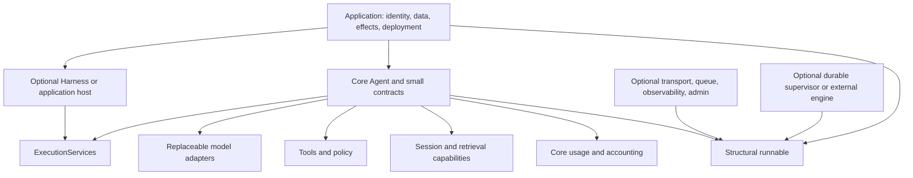

# Agentium: staff engineer SDK and runtime audit

**Verdict:** keep Agentium’s small model/tool contracts, ordinary Agent loop, neutral execution boundary, explicit harness composition, and core accounting. Its current implementation is a useful foundation, but its broad public surface and uneven state/lifecycle guarantees make production adoption substantially harder than the quickstart suggests. Repair those guarantees and narrow orchestration promises before adding capabilities. A new execution graph or universal plugin system would increase complexity without fixing the demonstrated problems.

This audit started **2026-10-10** and completed **2026-10-11**, Asia/Kolkata. Repository baseline: **`c5f9b5249d299f5d2d39b74c87b83f0da7c15570`**. Root and all ten packages: **4.8.2**. Initial working tree was clean. Final verification found no tracked diff and only `?? plans/2026-10-10-sdk-audit/`, containing these three reports; HEAD remained unchanged. Source, manifests, lockfiles and commits were read-only. Research access dates are recorded in [research.md](research.md). Detailed priorities, reproduction outcomes, tradeoffs and verification limits are in [findings.md](findings.md).

**Executed:** 446 selected existing tests passed, three report recipes typechecked and ran with local fakes, all 50 typed import paths loaded through ESM and CommonJS, consumer NodeNext type checks passed, four templates scaffolded/typechecked in temporary directories, and local fake probes demonstrated state, cancellation, persistence and delivery defects. Passing suites did not prevent those independent probes from finding failures. No dependency installation, live provider/database/hardware execution, paid call, publication, commit, or push occurred. Installed tools: Node **22.23.1**, TypeScript **5.9.3**, Zod **4.6.5**, Vitest **4.1.11**. Supported package engines are `^22.18.0 || ^24.11.0` (`packages/core/package.json:214`).

**Method:** the repository’s `.agents/skills/dx-audit/SKILL.md` owned public exports/type resolution, errors, configuration and CLI review. All 38 rules across api/types/err/cli/onboard/config were read; capability gates were applied rather than treating every missing flag as a defect. TypeScript, API/interface design, systematic debugging and the read-only improvement audit guidance informed the remaining review. The user’s requested S1–S4 ranking and three-report format take precedence over generic skill report templates.

## What Agentium actually is

Agentium is a Node-oriented TypeScript agent execution and integration SDK. Its central operation is an Agent’s model/tool loop, with shared contracts for messages, tools, run context, usage and observation. Team adds model-driven coordination recipes; Workflow adds stateful procedural steps; harness adds host-owned execution services, policy, resource lifetime and live conversation control. Separate transport/queue/admin/observability packages turn these runnables into application infrastructure. Core also exports independent memory, retrieval, protocols, realtime and durable-task facilities. The [published homepage](https://docs.agentium.in/) describes this composable SDK and optional packages, but the root export breadth makes the intended minimum harder to see.

**Source-inspected:** `ModelProvider` is structural and does not require inheritance (`packages/core/src/models/provider.ts:4`). `ServableAgent` lets external runnables use transport without Agent (`packages/core/src/serve.ts:20`); `defineExternalAgent` wraps application functions (`packages/core/src/agent/external-agent.ts:9`). `ExecutionServices` is genuinely neutral: core consumes host model/tool/state/input operations and does not import or instantiate harness (`packages/core/src/agent/execution-services.ts:17`). Harness depends on core, not the reverse. That separation earns retention.

The code in `packages/core/src/graph` is **knowledge-graph retrieval**: entities, relationships, traversal/search, semantic GraphMemory and raw Cypher retrieval (`packages/core/src/graph/types.ts:1`, `packages/core/src/graph/cypher-store.ts:5`). It is not an execution DAG. Workflow checkpoints and harness snapshots are not a durable execution engine. A separate durable task/action subsystem contains substantive fenced lease, intent, unknown-outcome and journal contracts (`packages/core/src/durable/README.md:39`, `:47`, `:69`); its production crash guarantees were not executed here.

The implied audience is an application developer who wants a ready loop plus tools and optional operational integrations, then grows into platform ownership. The examples favor a constructor, model factory, and one `run`; the sixth-month contracts assume the host understands storage guarantees, tenancy, borrowed resources, effects, accounting coverage and live-versus-durable continuation. Agentium can serve that audience if these responsibilities become explicit and consistently enforced. It should not compete simultaneously as a complete hosted memory product, database, deployment platform, workflow service and omnichannel application builder.

## Package and public API map

All packages are 4.8.2. Every feature package declares core as a peer. There are no observed runtime feature-package dependency cycles; some integrations import one another only for types or optional adapters. Core has **two required dependencies** (Zod and zod-to-json-schema), plus **27 optional peers**. The installation issue is therefore primarily API/compatibility breadth, not proven mandatory provider dependency bloat. A workspace containing every peer cannot prove installation without peers.

| Package | Root named symbols | Responsibility and boundary judgment | Manifest evidence |
|---|---:|---|---|
| `@agentium/core` | 740 | Agent, tools/models, Team/Workflow, sessions/storage/memory/retrieval, accounting, durable tasks, protocols, sandbox, tenancy/webhooks/realtime. Retain the center; isolate advanced integrations through intentional subpaths. | `packages/core/package.json:27`, `:89`, `:98` |
| `@agentium/harness` | 120 | Pure definitions/abilities plus binding runtime, drivers, controllers, policies, middleware, input/steering, watch. Keep optional. | `packages/harness/package.json:26`, `:60` |
| `@agentium/transport` | 65 | Express/SSE, Socket.IO, protocol bridges and gateway helpers. Keep optional, inject publication/identity ownership. | `packages/transport/package.json:26`, `:52` |
| `@agentium/queue` | 18 | BullMQ runs, workers, schedulers and durable-task delivery. Delivery is not itself resumable agent execution. | `packages/queue/package.json:26`, `:52` |
| `@agentium/eval` | 43 | Suites, scorers, specialist/conversational evaluation and reporters. Keep optional; accept structural application targets. | `packages/eval/package.json:26`, `:47` |
| `@agentium/observability` | 42 | Event instrumentation, traces/metrics, capture policy and exporters. Keep optional and observation-only. | `packages/observability/package.json:27`, `:48` |
| `@agentium/browser` | 29 | Browser-specific loop/action space/planner/vault; also exports heuristic helpers. Keep distinct runtime, narrow supported helpers. | `packages/browser/package.json:26`, `:47`, `:56` |
| `@agentium/admin` | 13 | Blueprint CRUD/configuration/entity/toolkit factories. Optional control-plane integration; avoid global ownership. | `packages/admin/package.json:26`, `:52` |
| `@agentium/edge` | 33 | Hardware integrations, presets, health monitoring and synchronization. Keep optional; runtime promises currently exceed behavior. | `packages/edge/package.json:28`, `:54`, `:78` |
| `@agentium/cli` | 4 | Scaffold, development runner, skill validation/install, npm publish wrapper. Keep small; core peer unnecessary for implementation except emitted code. | `packages/cli/package.json:27`, `:53`, `:56` |

### Counting method and support scope

**Executed inventory:** TypeScript checker `getExportsOfModule` on each concrete built ESM declaration entry, cross-checked against source exports. Star exports resolved. A named class counts once, even when both type and value. Aliases/re-exports count once **per import path**; class members, option fields, CLI commands, private declarations and package.json contents are excluded. Unique identities resolve to original declaration path/position/name. Wildcard expansion uses the current toolkit build targets, not every theoretically matchable string.

There are **16 manifest export keys** including one wildcard and core/package.json, **50 concrete typed import paths**, **1,486 named symbol slots** (**607 runtime**, **879 type-only**) and **1,251 unique declaration identities**. This is a reproducible compatibility-surface measure, not a count of concepts/features or of documented/stable promises. Root counts above are included in those totals. Additional aggregates: core/toolkits 80, core/voice 103, core/telephony 35, harness/testing 1. Toolkit wildcard paths contribute 160 slots, including the redundant toolkits/index aggregate alias.

Manifest exports support ESM `.js`/`.d.ts` and CJS `.cjs`/`.d.cts` (`packages/core/package.json:28`). All 50 paths loaded in both modes and typechecked from NodeNext `.ts` and `.cts` consumers, using installed peers and skipLibCheck. All 50 source/built named-symbol sets matched. This rechecks the previously repaired CJS declaration issue; it does not imply a fresh build, packed installation, missing-peer compatibility, or full library declaration checking.

Documented classes/factories and explicit harness testing belong to supported public contracts. Core loop helpers/ledger internals, browser search parsers, and the toolkit wildcard’s base/catalog/index helpers are also publicly importable; their intended semver support tier is unresolved (`packages/core/src/index.ts:41`, `packages/browser/src/index.ts:1`, `tsdown.config.ts:12`). Calling them “accidental” is an engineering judgment, not proven maintainer intent. Publish that intent before removing exports.

Existing raw dist bytes: core 3,963,497; harness 442,951; transport 407,896; browser 312,424; observability 203,592; edge 176,432; eval 108,520; admin 96,224; queue 64,122; CLI 26,124. These include distribution files and declarations, not compressed npm archives, install trees or bundled applications. No tree-shaking or cold-start measurement was executed. Core declares sideEffects false (`packages/core/package.json:80`) despite module-level model-registry population; runtime publication and tree-shaker behavior need a dedicated characterization before changing that declaration.

### Exhaustive manifest dependency/export inventory

The following inventory covers every package manifest export and required/peer dependency, including ranges and optional status. Development dependencies are build/test tooling rather than published runtime dependencies; they are inventoried below but excluded from runtime dependency direction. Expanded toolkit paths are listed separately. **Source-inspected and machine-counted**, with consumer execution described above.

#### Dependencies and optional peers

| Package | Required runtime dependencies | Peer dependencies (`?` = optional) | Evidence |
|---|---|---|---|
| `@agentium/admin` | none | `@agentium/core` ^4.8.2<br>`@types/express?` ^4.0.0 \|\| ^5.0.0<br>`express?` ^4.21.2 \|\| ^5.2.1<br>`socket.io?` ^4.8.4 | `packages/admin/package.json:52` |
| `@agentium/browser` | `zod` ^4.6.5 | `@agentium/core` ^4.8.2<br>`playwright` >=1.40.0 | `packages/browser/package.json:56` |
| `@agentium/cli` | `commander` ^12.0.0 | `@agentium/core` ^4.8.2 | `packages/cli/package.json:53` |
| `@agentium/core` | `zod` ^4.6.5<br>`zod-to-json-schema` ^3.24.0 | `@anthropic-ai/sdk?` >=0.30.0 <1<br>`@google/genai?` >=0.10.0 <3<br>`@qdrant/js-client-rest?` ^1.0.0<br>`better-sqlite3?` ^11.0.0<br>`mongodb?` ^6.0.0<br>`ollama?` ^0.5.0 \|\| ^0.6.0<br>`openai?` ^4.0.0 \|\| ^5.0.0 \|\| ^6.0.0 \|\| ^7.0.0<br>`@perplexity-ai/perplexity_ai?` >=0.20.0<br>`pg?` ^8.0.0<br>`@modelcontextprotocol/sdk?` ^1.27.1<br>`googleapis?` >=100.0.0<br>`pdf-parse?` ^2.4.5<br>`ioredis?` >=5.0.0<br>`@aws-sdk/client-s3?` >=3.0.0<br>`@aws-sdk/s3-request-presigner?` >=3.0.0<br>`discord.js?` >=14.0.0<br>`stripe?` >=14.0.0<br>`gpt-tokenizer?` >=3.0.0<br>`neo4j-driver?` >=5.0.0<br>`cohere-ai?` >=7.0.0<br>`dockerode?` >=4.0.0<br>`@typesafe-ai/sdk?` >=0.6.0<br>`@modelcontextprotocol/client?` ^2.3.0<br>`@huggingface/transformers?` ^4.3.0<br>`@a2a-js/sdk?` ^1.3.0<br>`@e2b/code-interpreter?` ~2.8.0<br>`@daytona/sdk?` ~0.220.0 | `packages/core/package.json:98` |
| `@agentium/edge` | `zod` ^4.6.5 | `@agentium/core` ^4.8.2<br>`node-libgpiod?` >=0.4.0<br>`i2c-bus?` >=5.0.0<br>`@stoprocent/noble?` >=2.0.0 | `packages/edge/package.json:54` |
| `@agentium/eval` | none | `@agentium/core` ^4.8.2 | `packages/eval/package.json:47` |
| `@agentium/harness` | `zod` ^4.6.5 | `@agentium/core` ^4.8.2 | `packages/harness/package.json:60` |
| `@agentium/observability` | none | `@agentium/core` ^4.8.2 | `packages/observability/package.json:48` |
| `@agentium/queue` | none | `@agentium/core` ^4.8.2<br>`bullmq?` ^5.81.5 \|\| ^6.3.11<br>`ioredis?` ^5.0.0 | `packages/queue/package.json:52` |
| `@agentium/transport` | none | `@agentium/core` ^4.8.2<br>`@types/express?` ^4.0.0 \|\| ^5.0.0<br>`express?` ^4.21.2 \|\| ^5.2.1<br>`multer?` ^2.3.0<br>`socket.io?` ^4.8.4<br>`swagger-ui-express?` ^5.0.0<br>`@a2a-js/sdk?` ^1.3.0<br>`@modelcontextprotocol/server?` ^2.3.0 | `packages/transport/package.json:52` |

#### Development and private workspace dependencies

All ten packages declare `@types/node ^25.3.1`, `typescript ^5.6.0`, and `tsdown 0.23.0` as development dependencies; browser additionally declares `playwright ^1.58.2`. These do not become mandatory published runtime dependencies. Their exact declarations are in each manifest’s devDependencies block, e.g. `packages/core/package.json:93` and `packages/browser/package.json:50`. The private root workspace also declares the following groups; they are repository tooling/workspace linkage rather than a consumer installing core.

| Root manifest group | Dependency/range | Evidence |
|---|---|---|
| `dependencies` | `@anthropic-ai/sdk` ^0.131.0 | `package.json:80` |
| `dependencies` | `@google/genai` ^2.27.0 | `package.json:80` |
| `dependencies` | `@modelcontextprotocol/sdk` ^1.27.1 | `package.json:80` |
| `dependencies` | `@qdrant/js-client-rest` ^1.17.0 | `package.json:80` |
| `dependencies` | `@types/express` ^5.0.6 | `package.json:80` |
| `dependencies` | `express` ^5.2.1 | `package.json:80` |
| `dependencies` | `mongodb` ^6.21.0 | `package.json:80` |
| `dependencies` | `multer` ^2.3.0 | `package.json:80` |
| `dependencies` | `socket.io` ^4.8.4 | `package.json:80` |
| `dependencies` | `swagger-ui-express` ^5.0.1 | `package.json:80` |
| `devDependencies` | `@a2a-js/sdk` 1.3.0 | `package.json:49` |
| `devDependencies` | `@biomejs/biome` ^2.5.14 | `package.json:49` |
| `devDependencies` | `@modelcontextprotocol/client` 2.3.0 | `package.json:49` |
| `devDependencies` | `@modelcontextprotocol/server` 2.3.0 | `package.json:49` |
| `devDependencies` | `better-sqlite3` ^11.10.0 | `package.json:49` |
| `devDependencies` | `bullmq` 6.3.11 | `package.json:49` |
| `devDependencies` | `bullmq-v5` npm:bullmq@5.81.5 | `package.json:49` |
| `devDependencies` | `cohere-ai` ^8.1.0 | `package.json:49` |
| `devDependencies` | `husky` ^9.1.7 | `package.json:49` |
| `devDependencies` | `ioredis` ^5.9.3 | `package.json:49` |
| `devDependencies` | `lint-staged` ^16.2.7 | `package.json:49` |
| `devDependencies` | `openai` ^7.30.0 | `package.json:49` |
| `devDependencies` | `pdf-parse` 2.4.5 | `package.json:49` |
| `devDependencies` | `pg` ^8.23.1 | `package.json:49` |
| `devDependencies` | `socket.io-client` ^4.8.4 | `package.json:49` |
| `devDependencies` | `tsdown` 0.23.0 | `package.json:49` |
| `devDependencies` | `tsx` ^4.23.15 | `package.json:49` |
| `devDependencies` | `vitest` ^4.0.18 | `package.json:49` |
| `devDependencies` | `zod-v3` npm:zod@3.25.76 | `package.json:49` |
| `devDependencies` | `zod-v4` npm:zod@4.6.5 | `package.json:49` |

#### Every concrete typed import path

All rows have conditional ESM/CJS code and declaration targets. `core/package.json` is the additional untyped JSON export. Manifest keys for core are `.`, `./toolkits`, `./toolkits/*`, `./package.json`, `./voice`, `./telephony`; harness has `.` and `./testing`; the other eight packages have only `.`. The CLI also has an `agentium` bin (`packages/cli/package.json:24`).

| Import path | Named symbols | Runtime / type-only |
|---|---:|---:|
| `@agentium/admin` | 13 | 5 / 8 |
| `@agentium/browser` | 29 | 13 / 16 |
| `@agentium/cli` | 4 | 4 / 0 |
| `@agentium/core` | 740 | 303 / 437 |
| `@agentium/core/toolkits` | 80 | 40 / 40 |
| `@agentium/core/voice` | 103 | 35 / 68 |
| `@agentium/core/telephony` | 35 | 9 / 26 |
| `@agentium/core/toolkits/base` | 5 | 3 / 2 |
| `@agentium/core/toolkits/calculator` | 2 | 1 / 1 |
| `@agentium/core/toolkits/calendar` | 2 | 1 / 1 |
| `@agentium/core/toolkits/catalog` | 2 | 2 / 0 |
| `@agentium/core/toolkits/code-interpreter` | 2 | 1 / 1 |
| `@agentium/core/toolkits/discord` | 2 | 1 / 1 |
| `@agentium/core/toolkits/duckduckgo` | 2 | 1 / 1 |
| `@agentium/core/toolkits/filesystem` | 2 | 1 / 1 |
| `@agentium/core/toolkits/git` | 2 | 1 / 1 |
| `@agentium/core/toolkits/github` | 2 | 1 / 1 |
| `@agentium/core/toolkits/gmail` | 2 | 1 / 1 |
| `@agentium/core/toolkits/google-sheets` | 2 | 1 / 1 |
| `@agentium/core/toolkits/google-workspace` | 2 | 1 / 1 |
| `@agentium/core/toolkits/hackernews` | 2 | 1 / 1 |
| `@agentium/core/toolkits/http` | 2 | 1 / 1 |
| `@agentium/core/toolkits/image-generation` | 2 | 1 / 1 |
| `@agentium/core/toolkits/index` | 80 | 40 / 40 |
| `@agentium/core/toolkits/jev` | 2 | 1 / 1 |
| `@agentium/core/toolkits/jira` | 2 | 1 / 1 |
| `@agentium/core/toolkits/notion` | 2 | 1 / 1 |
| `@agentium/core/toolkits/pageindex` | 2 | 1 / 1 |
| `@agentium/core/toolkits/pdf` | 2 | 1 / 1 |
| `@agentium/core/toolkits/redis` | 2 | 1 / 1 |
| `@agentium/core/toolkits/s3` | 2 | 1 / 1 |
| `@agentium/core/toolkits/sandbox-daytona` | 6 | 2 / 4 |
| `@agentium/core/toolkits/sandbox-e2b` | 5 | 2 / 3 |
| `@agentium/core/toolkits/scraper` | 2 | 1 / 1 |
| `@agentium/core/toolkits/shell` | 2 | 1 / 1 |
| `@agentium/core/toolkits/slack` | 2 | 1 / 1 |
| `@agentium/core/toolkits/sql` | 2 | 1 / 1 |
| `@agentium/core/toolkits/stripe` | 2 | 1 / 1 |
| `@agentium/core/toolkits/telegram` | 2 | 1 / 1 |
| `@agentium/core/toolkits/websearch` | 2 | 1 / 1 |
| `@agentium/core/toolkits/whatsapp` | 2 | 1 / 1 |
| `@agentium/core/toolkits/wikipedia` | 2 | 1 / 1 |
| `@agentium/core/toolkits/youtube` | 2 | 1 / 1 |
| `@agentium/edge` | 33 | 19 / 14 |
| `@agentium/eval` | 43 | 19 / 24 |
| `@agentium/harness` | 120 | 33 / 87 |
| `@agentium/harness/testing` | 1 | 1 / 0 |
| `@agentium/observability` | 42 | 13 / 29 |
| `@agentium/queue` | 18 | 5 / 13 |
| `@agentium/transport` | 65 | 28 / 37 |

## Capability status and boundary coverage

“Usable” here means a representative local journey works or a substantial implementation/contract exists; it is not certification of every adapter. The ledger deliberately distinguishes deep inspection from boundary samples.

| Capability | Classification and evidence | Coverage / remaining limits |
|---|---|---|
| Agent, typed tools, custom models | Implemented and locally usable; real source Agent with fake ModelProvider and deterministic eval; selected loop/tool suites pass. Exact cancellation/cap defects remain. | Deep source + sampled execution; native provider services unverified. |
| Team | Implemented recipes, inconsistent semantics; native handoff blocked, shared memory inactive, collaboration exhaustion loses evidence. | Deep modes/options/tests; fake probes. |
| Workflow | Implemented procedural orchestration/checkpoint browsing; parallel merge and repeated replay incorrect. Best-effort continuation is intentional but insufficiently explicit. | Deep source/tests/probes; no durable effect claim. |
| Harness | Implemented explicit composition/control/input/steering and resource ownership; strong local tests. Async custom persistence gap. | Deep contract/runtime sample; live closures not recoverable. |
| Cost/budgets | Implemented canonical accounting with exact decimal/unpriced evidence, attempt roles and atomic-store capability gates; legacy sync inconsistency. | 105 tests + fake ledger probe; invoice/remote stores unverified. |
| Sessions/storage | Useful small custom ports; multi-owner append and partial-write recovery unsafe in ordinary managers. Scope collisions demonstrated. | Deep common managers/in-memory; external drivers sampled. |
| Memory | Implemented optional components/extraction; direct remember can no-op, incomplete work drain. Rich recall semantics vary by store. | Deep facade and sampled components; quality/large corpus unmeasured. |
| Knowledge/vector/graph | Implemented ingestion/retrieval; vector fake path works, lexical corpus lifecycle gap, generated Cypher authority unsafe with write-capable backend. | Deep key paths; embedders/local-model download and real DB not run. |
| Eval | Real-Agent deterministic evaluation usable; target nominally coupled. Deadline/score/session integrity tested. | Selected integrity suite + own case + negative consumer type test. |
| CLI | Four scaffolds/typechecks usable; local skill validates; config-only voice starts, basic missing-model error actionable. | Safe commands executed; installs/publish/provider templates not run. |
| Transport/queue | Substantial optional delivery/HTTP/socket interfaces; structural runnable integration. | Boundary manifests/types/readmes/representative implementation; no sockets/Redis/network auth execution. |
| Admin | Config/entity control plane; Workflow blueprints descriptive rather than hydrated runnables. | Boundary source; persisted server interactions unverified. |
| Observability | Separate exporters/capture policies; EventBus isolates returned observer errors. Tool/external/webhook lifecycle gaps are adapter issues. | Boundary contracts + selected local event probes; remote export unverified. |
| Browser | Separate runtime/planner/actions; coherent specialized authority requirement. | Boundary readmes/public surface; Playwright navigation/model planning not run. |
| Edge | Hardware toolkit/health observer implemented; README blocked and restart/shedding promises incomplete. | Exact README negative typecheck; no hardware/Ollama call. |
| Voice/realtime/telephony | Distinct realtime/media/carrier contracts implemented; explicit transport/intent/auth ownership is useful. | Boundary sources/readmes; only voice config startup, no media/speech/PSTN. |
| A2A/MCP | Optional protocol clients/adapters, distinct version/task contracts. | Boundary API/test inventory and selected source; no live interoperability/remote permission validation. |
| Sandbox | Optional subprocess tool path; requires deployment authority separate from prompt/guardrails. | Boundary types/readme/worker sample; no adversarial OS confinement testing. |
| Durable tasks | Substantive supervisor/action/lease/journal design, qualified guarantees. | README/types/supervisor deep sample; Mongo fencing/SIGKILL integration tests not run. |
| Tenancy/webhooks/toolkits | Scoping helpers are not auth; webhook failure probes fail; toolkit factory composition useful with external-service ownership. | Scoping/delivery executed; all toolkit names inventoried, implementations sampled. |
| Execution graph, recoverable suspended harness turn | Not implemented/claimed as usable by inspected contracts. Snapshot documentation explicitly limits it. | No recommendation to invent these without a concrete requirement. |

## The first hour and sixth month

These are **journey estimates by engineering judgment**, not timed onboarding experiments. The implementation gives a quick useful result once credentials/installed tooling are present; production cost often appears when ownership, persistence, retries and provider escape matter. Eight journeys below show application code in actual 4.8.2 shapes. Snippets use named application dependencies where indicated; only specifically labelled cases were executed. Proposed APIs live in findings and are marked hypothetical.

### 1. Minimal agent, provider swap, native options

**Executed equivalent with a source fake; source-inspected public API.** This fake allows deterministic local adoption without credentials:

```ts
import { Agent, type ModelProvider } from "@agentium/core";

const fake: ModelProvider = {
  providerId: "local-fake", modelId: "fixture",
  async generate() {
    return {
      message: { role: "assistant", content: "4" },
      usage: { promptTokens: 1, completionTokens: 1, totalTokens: 2 },
      finishReason: "stop", raw: {},
    };
  },
  async *stream() {
    yield { type: "text", text: "4" };
    yield { type: "finish", finishReason: "stop",
      usage: { promptTokens: 1, completionTokens: 1, totalTokens: 2 } };
  },
};
const agent = new Agent({ name: "math", model: fake, register: false });
try { console.log((await agent.run("2+2?")).text); }
finally { await agent.close(); }
```

Swapping to `openai(modelId)` or `anthropic(modelId)` keeps Agent code small; provider factories and credentials must be configured explicitly. `providerOptions:{serviceTier:"priority"}` reaches one OpenAI knob today (`packages/core/src/models/types.ts:161`). Neither service calls nor capability equivalence were executed. Provider-native client/fetch injection is missing in these adapters: [F13](findings.md#f13--add-typed-provider-owned-native-escape-hatches).

First hour: two methods to fake, one constructor/run/close, low boilerplate; easy text/tool portability. Sixth month: application owns credential rotation/native capability choice, while Agentium should own consistent retry/cancel/usage boundaries. A provider swap cannot erase opaque replay requirements or decision-vs-chat differences. Jev/OpenAI Decisions are verified question/decision providers, with specialized fields leaking into shared request/output types; capability discrimination earns more than pretending universal portability.

### 2. Tools, stream, cancellation, retries and thrown work

**Source-inspected; fake throw/abort/cap/retry probes executed.** `defineTool` infers args from Zod 3/4 Classic/Mini schemas (`packages/core/src/tools/schema.ts:17`, `packages/core/src/tools/define-tool.ts:5`). Application lookup is host-owned:

```ts
import { defineTool, Agent } from "@agentium/core";
import { z } from "zod";
const lookup = defineTool({
  name: "lookup", description: "Read an application record",
  parameters: z.object({ id: z.string() }),
  execute: async ({ id }, ctx) => {
    ctx.signal?.throwIfAborted();
    return JSON.stringify(await applicationLookup(id, ctx.signal));
  },
});
const abort = new AbortController();
const agent = new Agent({ name: "reader", model, tools: [lookup],
  register: false, retry: { maxRetries: 2 }, maxToolRoundtrips: 3 });
try {
  for await (const chunk of agent.stream("Read record 42", { signal: abort.signal })) {
    if (chunk.type === "text") process.stdout.write(chunk.text);
  }
} finally { await agent.close(); }
```

First hour: typed args and model-visible tool failures are convenient. SDK turns thrown tools into result errors; the application must check terminal outcome and await iterator exhaustion. Sixth month: application owns effect idempotency and cooperative cancellation inside its dependencies; SDK should prevent post-abort dispatch, exact cap overruns and incomplete events. Current run/stream retry behavior diverges and Agent does not expose ToolExecutor’s concurrency option ([F01](findings.md#f01--share-cancellation-retry-and-tool-cap-invariants), A04–A07). Five parallel tools by default may be wrong for a mutable business resource. Native provider SDK retry ownership must be explicit to predict latency/cost.

### 3. Bring an execution loop/driver; human input and steering

**Source-inspected custom-driver recipe; selected conversational suites executed.** A driver can use the runtime’s services without implementing the full host:

```ts
import { HarnessRuntime, type ExecutionDriver } from "@agentium/harness";
const driver: ExecutionDriver = {
  id: "application", version: 1,
  capabilities: { controls: [], durable: false,
    policyCoverage: "local", controlledExecution: true },
  async start(request, services) {
    const reply = await services.requestInput({ question: "Which account?", choices: ["A", "B"] });
    services.append([
      { role: "user", content: request.input },
      { role: "assistant", content: String(reply.input) },
    ]);
    return { text: String(reply.input) };
  },
};
const runtime = new HarnessRuntime({ driver, grants: { toolIds: [], modelRoles: [] } });
const handle = runtime.start("Choose account", {
  identity: { tenantId: verifiedTenant, userId: verifiedActor }, sessionId: "s",
});
for await (const event of handle.events()) {
  if (event.payload.type === "input.requested") await handle.reply(event.payload.request.id, "A");
}
const result = await handle.result();
```

`verifiedTenant/verifiedActor` come from host authentication. Agent driver advertises steering controls; the minimal custom driver above advertises none. Send only modes the chosen driver supports, e.g. `handle.send(text,{mode:"steer"})` for an appropriate adapter. RunHandle input is live, correlated and distinct from tool approval (`packages/harness/src/runtime/driver.ts:133`). One pending question, input-wait versus active deadlines, FIFO steering after a settled batch and final-call races have focused tests (`packages/harness/src/__tests__/conversational-runs.test.ts:195`).

First hour: driver capabilities, identity, grants and event/result handles introduce more concepts than plain Agent. Sixth month: explicit authority and resource ownership earn them. Arbitrary SDK calls inside a trusted driver bypass runtime budgets/policy/telemetry; use `services.model/streamModel/dispatch/runOwned`. A host implementing ExecutionServices itself faces roughly twenty members, so split optional subports only when actual adapters demonstrate need. For existing application loops, `defineExternalAgent({name,register:false,run:applicationRun})` is simpler, with lifecycle issues in A04. Persisted history does not resurrect suspended closures; async write acknowledgment still needs [F06](findings.md#f06--await-harness-session-commit-and-release).

### 4. Team, Workflow, Harness or plain TypeScript

**Source-inspected; Workflow/Team fake probes executed.** For two deterministic calls, ordinary code is the best baseline:

```ts
const draft = await writer.run(input, { signal, ephemeral: true });
const review = await reviewer.run(draft.text, { signal, ephemeral: true });
return review;
```

Use Workflow when step records/conditions/state browsing are worth a step API:

```ts
import { Workflow } from "@agentium/core";
const workflow = new Workflow({ name: "review", register: false,
  initialState: { input, text: "" },
  steps: [{ name: "draft", run: async state => ({ text: (await writer.run(state.input)).text }) }],
});
const result = await workflow.run(); // inspect stepResults, including errors
```

Use Team for deliberate model-selected coordination, not merely Promise.all. Its prompt orchestration introduces coordinator cost, member session suffixes and mode-specific outcomes. Native Team handoff is currently blocked and configuration promises drift ([F10](findings.md#f10--give-handoff-one-lifecycle-owner)). Use Harness when the host must centrally control grants, models, budgets, human input, context and completion revisions. It should be an opt-in environment around a loop rather than a prerequisite for calling models.

First hour: four overlapping names lack a crisp selection ladder; start with Agent/plain functions. Sixth month: dependency failure policy and state ownership matter more than syntax. Workflow today collects errors and continues; it is not equivalent to awaited functions or a durable engine. Repair patch/replay contracts and make failure policy explicit ([F04](findings.md#f04--merge-workflow-branch-writes-not-copied-input), [F05](findings.md#f05--preserve-checkpoint-cursor-identity-across-replay), A02). If resumable waits/versioned recovery are essential, adapt an external durable engine or the existing qualified task supervisor. Do not add an execution graph just to fix these bugs.

### 5. Sessions, memory and knowledge with custom stores

**Source-inspected API; fake store/reconstruction probes executed.** KV storage needs get/set/delete/list/close, optional initialize. Vector and graph stores have separate contracts; one “store” does not imply all guarantees.

```ts
import { MemoryManager, KnowledgeBase } from "@agentium/core";
const memory = new MemoryManager({ storage: hostStore, userFacts: true, summaries: false });
await memory.getOrCreateSession("s", "u");
await memory.remember("User prefers TypeScript", { userId: "u" });
const facts = await memory.recall("TypeScript", { userId: "u" });

const knowledge = new KnowledgeBase({ name: "docs", vectorStore: hostVectorStore });
await knowledge.add({ id: "guide", content: applicationDocument });
const hits = await knowledge.search(question);
const result = await agent.run(JSON.stringify({ question, facts, documents: hits }));
```

These names are core exports; stores/documents are application dependencies. Choose one memory owner: the standalone manager above, or Agent’s `memory:{storage,...}`; do not accidentally create two session owners. Host scopes storage to authenticated identities and defines authority/retention. Agent opts `sessionId/userId/tenantId` do not automatically namespace arbitrary stores. Automatic extraction can make model calls; this recipe does not claim extraction is free/deterministic.

First hour: explicit userFacts matters—default remember can succeed without storing anything. Sixth month: ordinary managers need atomic mutation/recovery, a versioned identity codec, complete listing, and drain ownership ([F02](findings.md#f02--encode-storage-tuples-without-collisions), [F03](findings.md#f03--define-atomic-session-mutation-and-recovery-capabilities), [F11](findings.md#f11--drain-all-owned-memory-work-before-closing-its-store)). Persistent vector data does not persist KnowledgeBase BM25 ([F12](findings.md#f12--give-lexical-retrieval-a-corpus-lifecycle)). Harness canonical history and Agent backing sessions/search_past_sessions are explicitly different (`packages/harness/README.md:109`), a real concept cost. Escape through external history/ephemeral runs and application-owned retrieval tools is useful and should stay.

### 6. Deterministically evaluate the application’s own agent

**Executed real Agent plus fake ModelProvider: one case passed, no provider calls.** Reuse the fake from journey 1:

```ts
import { EvalSuite, contains } from "@agentium/eval";
const applicationAgent = new Agent({ name: "evaluation", model: fake, register: false });
try {
  const result = await new EvalSuite({
    name: "application", agent: applicationAgent,
    cases: [{ name: "addition", input: "2+2?", expected: "4" }],
    scorers: [contains("4")],
  }).run();
} finally { await applicationAgent.close(); }
```

First hour: two packages, familiar case/scorer structure, tiny deterministic fake. Sixth month: shared memory/effects still need fixture isolation; scripted model judges/users are deterministic, provider-backed ones are not. Current EvalSuite requires concrete Agent even though execution needs run; a structural wrapper was rejected by the public TypeScript consumer ([F14](findings.md#f14--evaluate-an-application-target-without-adopting-agent)). Retain strict score/deadline/result integrity rather than replace eval wholesale. An application may use promptfoo/Evalite/Braintrust instead; Agentium outputs should be easy to project into those systems.

### 7. Account for cost, inspect it and enforce budgets

**Source-inspected recipe; synthetic tariff/ledger and 105 accounting tests executed.**

```ts
import { CostTracker, Agent } from "@agentium/core";
const costs = new CostTracker({ budget: {
  mode: "threshold", onExceeded: "throw", onUnknown: "block",
  limits: [{ scope: "session", amount: "2", currency: "USD",
    period: { start: "2026-10-01T00:00:00Z", end: "2026-11-01T00:00:00Z" } }],
} });
const agent = new Agent({ name: "metered", model, costTracker: costs, register: false });
try {
  const result = await agent.run(input, { tenantId, sessionId });
  console.log(result.costs?.total, result.costs?.knownSubtotal);
  console.log(await costs.queryCosts({ tenantId, sessionId }));
} finally {
  await agent.close(); // borrowed tracker remains host-owned
  await costs.close();
}
```

For simplest accounting, `cost:true` owns a tracker and result snapshot. Unknown pricing produces null total and known subtotal, not zero spend (`packages/core/README.md:186`). A fake/custom model needs an explicit catalog to price its synthetic usage; unknown-block policy is intentionally conservative. Threshold admission may overshoot while a call runs; strict reservation needs atomic shared accounting and a conservative per-attempt bound (`packages/core/README.md:232`). Neither guarantees an invoice.

First hour: opt-in accounting is now clear, unlike older manual tracking. Sixth month: host owns scope attribution, catalog versions, actual billing facts and shared-store guarantees. Core tracks observable physical attempts/auxiliary work and separates usage evidence from assessment. Direct native calls outside the wrapper remain outside its coverage. Legacy synchronous budget APIs still silently disagree with canonical totals ([F08](findings.md#f08--reject-incompatible-synchronous-budget-reads)); move to scoped async reads. Retain cost in core as previously decided.

### 8. Scaffold locally and add a skill

**Executed local built CLI, temporary scaffold and local-skill validation.**

```sh
# Executed from a temporary cwd; no install or model run followed.
node /Users/xerycks/Xhip/agentium/packages/cli/dist/bin.js init basic --template basic
node /Users/xerycks/Xhip/agentium/packages/cli/dist/bin.js skills install ./skills/example
```

The local folder must contain SKILL.md. Installation validates it, then tells the host to register explicitly (`packages/cli/src/commands/skills.ts:6`). Application configuration uses `skillDirs:[approvedSkillDirectory]`; AgentConfig also accepts loaded Skill objects/sources (`packages/core/src/agent/types.ts:41`, `:115`). An npm/Git source invokes npm install with scripts disabled; not executed here. No unified plugin discovery/install runtime is implied.

First hour: all basic/RAG/voice/browser templates scaffolded and typechecked using existing dependencies. Basic closes its Agent and requires OPENAI_MODEL; RAG actually supplies retrieved evidence; voice makes media transport ownership explicit (`packages/cli/src/commands/new.ts:23`). Config-only voice startup worked. Sixth month: CLI should stay a thin local utility, use installed tooling predictably, and print actionable errors. Invalid template/name/destination/skill errors include internal stacks; dev invokes npx despite an installed-tool requirement (A09). Publish is a convenience npm wrapper, not an Agentium deployment model. No reason to build a larger CLI framework before fixing those small contracts.

## Coherent extension contracts, with boundaries

Agentium has multiple extension points, **not one unified plugin system**. Standardization earns its cost where it preserves authority and continuation; merging every callback into a plugin would hide meaningful distinctions.

| Extension | What it should own | Current assessment / smallest useful improvement |
|---|---|---|
| ModelProvider/embedders | native request adaptation, normalized responses/usage; independent vector encoding | Keep structural ports; typed native options/client injection and conformance tests. Do not equate chat and decision capability. |
| ToolDef/toolkits/skills | callable capability/schema/result; bundles and source instructions | Keep schema inference, raw JSON-schema bridge for MCP. Support other schemas only through a validated conversion adapter, not universal inference claims. |
| Agent hooks/loop hooks | local lifecycle and prompt/response adaptation | Useful lightweight escape; state allowed transformations and error semantics. Do not use observer events for mandatory decisions. |
| Guardrails/execution policy/approval | validation versus authority and human approval | Keep distinct. Mandatory policy must not be replaceable by hooks or tool exemption; missing approval fails closed. |
| Harness abilities/middleware | pure definition then run binding, ordered transforms/observation | Keep lifecycle separation and ordering validation (`packages/harness/README.md:150`). Avoid another automatic registry. |
| Controller/context/completion policies | choose next model/tools; project context; accept/revise output | Distinct roles earn complexity. controlModel avoids recursive policy calls and shares budgets (`packages/harness/src/runtime/driver.ts:658`). Document selection ladder and one owner per concern. |
| Driver/ExecutionServices | execution strategy versus host authority, state and work lifetime | Keep core-neutral boundary; capability honesty and optional subports only for demonstrated hosts. |
| EventBus/observability/webhooks | observations and delivery diagnostics | Keep isolation/observation-only. Repair adapter promise/event ownership, not mandatory async bus dispatch. |
| Storage/session/vector/graph/accounting stores | domain persistence guarantees, atomicity, corpus lifetime | Retain separate small ports; add optional domain capabilities and versioned codecs rather than a universal database interface. |

### State, concurrency and operational ownership

Agent creates run-local loop/executor state (`packages/core/src/agent/agent.ts:475`), a strength for simultaneous runs. Tool batches settle started work before parent failure/control transfer (`packages/core/src/tools/tool-executor.ts:181`); approvals snapshot reviewed args and fail on mutation (`:265`) or missing required approval (`:299`). These are more valuable than maximal pluggability. App code owns transaction/idempotency semantics for external effects; Agentium must own its own caps, cancellation, transcript pairing and terminal observation.

Team combines member/coordinator state and mode-specific prompts; some options are unused or incompletely forwarded. Workflow owns procedural state but promises less than a durable workflow engine; today its merge/replay contracts are incorrect. Harness owns canonical conversations, session leases, run resources and budgets; Agent adapter uses ephemeral history to avoid duplicate persistence (`packages/harness/README.md:53`). Session, extraction, vector corpus, pricing ledger and live turn all have different lifetimes; treating them as one “memory” or “storage” misleads adopters.

Durable tasks already model unknown external outcomes and reconciliation rather than promise exactly-once arbitrary effects (`packages/core/src/durable/README.md:49`, `:51`). Keep this qualified contract; pair it with explicit deployment/store/reconciler ownership. Transport, queues and protocols should route/delegate without claiming remote local-policy coverage. Telephony’s authorization/fetch/timeouts and intent-store pattern are useful precedents for narrower integrations. Voice/browser are specialized loops with different authorities; forcing them under one universal Agent would lose clarity.

### Implicit behavior inventory

These are **source-inspected**, not all executed against external adapters:

| Behavior | Trigger / owner | Evidence and implication |
|---|---|---|
| Entity publication | Agent/Team/Workflow construction unless register:false | `packages/core/src/agent/agent.ts:470`; global replacement/discovery, F15. Close does not remove publication. |
| Built-in model factory population | Model registry module evaluation | `packages/core/src/models/registry.ts:51`; shared mutable factory table and any-typed config. Explicit instance injection avoids it. |
| Shared observers/log | EventBus.shared opt-in; default SSE event log module object | `packages/core/src/events/event-bus.ts:29`, `packages/transport/src/sse-event-log.ts:103`; Agent normally has its own bus. Specify scope/retention rather than assume every event is global. |
| Provider environment/client state | OpenAI construction or first call without key | `packages/core/src/models/providers/openai.ts:23`, `:41`, `:55`; SDK require, OPENAI_API_KEY fallback, per-key client cache capped at 50. Environment/client lifetime can outlive one request. Other providers were sampled, not exhaustively traced here. |
| Storage initialization | MemoryManager construction | `packages/core/src/memory/memory-manager.ts:52`; initialize may open host resources before first run. Async lifetime must be owned. |
| Feature defaults/work | Memory sessions/summaries default; optional facts/learnings; run background extraction | `packages/core/src/memory/memory-manager.ts:56`, `:60`, `:362`; absent remember destination and work drain differ, F11/A01. Model-backed work is not a free read. |
| Files/skills/context | Explicit Agent skillDirs/contextFiles/workspace feature configuration | `packages/core/src/agent/types.ts:41`, `:46`; discovery/filesystem work belongs to enabled initialization, not pure harness define/describe. Avoid network-backed skill sources without explicit deployment policy. |
| Hidden retry/counting defaults | Generic retry and provider SDK layers; plain tool cap | `packages/core/src/utils/retry.ts:8`; three generic retries with jitter/backoff, SDK behavior separate. F01 calls for one owner and exact effect boundaries. |
| Toolkit discovery/build surface | Explicit factory catalog; build enumerates toolkit .ts files | `tsdown.config.ts:12`; wildcard exports broaden whenever files are added. No unified plugin runtime is implied. |

## Recommended structure

**Compatible first:** retain all existing packages and root aliases. Define a small primary core surface: Agent, ModelProvider/messages, tools, RunContext/result, execution policy, sessions and cost opt-in. Add intentional advanced subpaths such as execution/testing, storage, retrieval, durable and protocol adapters, with an explicit support tier. Accounting stays in core. Existing voice/telephony/toolkit separation is directionally sound. Reject arbitrary new root exports in review until a use case and compatibility commitment are clear.

**Then narrow:** Team should contain a few distinct coordination recipes with explicit outcomes; remove redundant handoff after migration. Workflow should remain optional lightweight procedural composition/debugging, with patch/cursor/failure guarantees. Harness remains a host environment and lifecycle layer around replaceable drivers. Simplify default docs to Agent → plain functions → choose one additional abstraction based on a concrete need.

**Only split physical packages when operational differences justify it:** provider/native adapters, protocols, carrier/realtime/sandbox dependencies are optional integrations; subpaths may suffice given today’s small mandatory footprint. Keep transport, queue, observability, browser and Edge optional. Admin becomes an injected control-plane adapter, not the global SDK owner. Do not create a separate cost package against the examined prior decision or merge core and harness merely to shorten imports. A physical split adds coordinated releases/peer matrices and may yield less than a supported subpath.



The diagram shows contract relationships, not a claim that all arrows provide durability or policy interception. There is no core-to-harness package dependency.

## Staged roadmap and acceptance gates

| Stage | Concrete change | Acceptance / compatibility |
|---|---|---|
| Immediate correctness | Fix retry/abort/tool caps, parallel patches, replay absolute cursor, scoped tuple codec, loose-log recovery, awaited harness commit, webhook promise/batch retention, canonical legacy guards. | Fake invariant matrix and failure-boundary tests. Migration plan before shipping changed persisted keys/checkpoint acceptance. No new execution engine. |
| Immediate contract honesty | Fix Edge example, declare health observer/host restart, deprecate inactive Team/Workflow config, document buffered Team.stream and Workflow continuation, concise CLI errors/local dev executable. | Extracted examples typecheck; every accepted option has behavior or a rejection/deprecation. No downloads in local probes. |
| Compatible composability | Structural EvalTarget; injected registries/admin and registration handles; native client/typed provider options; bounded memory drain; optional atomic SessionStore and lexical backend capability. | Consumer type tests, borrowed ownership tests, two independent writers, remote ack order, restart retrieval parity, provider conformance with fakes. Preserve primary Agent adoption path. |
| Supported surface | Publish primary/advanced/internal tiers, explicit subpaths/toolkit exports, module/state side-effect inventory, representative examples and migration guides. | Export/peer/NodeNext ESM+CJS packed-consumer CI using controlled installation, examples tested without providers; no build-only capability assertions. |
| Next major, only after additive path | Default unregistered construction; remove obsolete Team handoff/inactive settings; consider stop-on-error Workflow default and typed terminal/structured outcomes; retire deprecated sync canonical reads/root internals. | Mechanical codemods or direct before/after guides, release compatibility tests, persistent-data migration/rollback plan. Breaking changes need customer use evidence, not cosmetic symmetry. |
| Later evidence-driven integrations | Adapter to existing durable engine when deployment needs recoverable waits/versioning; memory service integration when corpus/quality/operations warrant it. | Failure/reconciliation/restart tests with explicit external service ownership. Do not market ordinary runs as durable. |

Maintainer work should focus on a reusable transition/invariant test layer rather than immediately rewriting the two large run/stream loops. Add a provider through the structural port first; first-party support additionally requires native option types, registry/export updates, usage/replay mapping and conformance tests. Adding an event needs payload compatibility, identity, one start/terminal pairing and no authority change. Existing tests often pin happy-path status without values, or mock a protocol the real Agent no longer uses; real-contract composition tests offer higher leverage than more isolated mocks.

## Prior decisions and release cost

Prior plans were read before source: `plans/README.md`, core-cost accounting and DX reviews/implementation, catalog verification and conversational-run plans. **Keep cost in core:** accounting is an execution invariant; optional adapters/subpaths are enough. **Keep EventBus observation-only:** direct admission/accounting writes own control; isolated observers should not rerun providers. F07 is an adapter discarding promises, not evidence against that decision. Previously repaired CJS declarations passed fresh consumer probes. Prior unpriced/usage/reasoning issues are not repeated as current defects.

Local changelog/tags show intentional v3 removals/toolkit isolation and v4 harness migration (`CHANGELOG.md:79`); v4.5 documented canonical accounting migration (`CHANGELOG.md:40`); later 4.7/4.8 embedder additions and 4.8.1/4.8.2 service-tier widening. Release frequency alone is not evidence of instability. Removing Agent.deep and requiring explicit defaults/grants is real migration work, justified by ownership/authority clarity (`packages/harness/README.md:55`). v4.5 preserved some signatures but made synchronous accounting reads throw; that is real runtime migration cost and exposes F08’s remaining inconsistency. A semver-preserved TypeScript signature does not guarantee behavior compatibility.

The public docs homepage was read; some attempted markdown/document fetches were unavailable to the research tool. That is a research limitation, not proof the website is broken or universally stale. Local Edge README failure is independently executed. Benchmarks are historical provider-backed comparisons, not current reliability/performance proof; details in research.

## If building Agentium today

**Keep:** a small structural model contract, inferred tools with authority separate from validation, an ordinary bounded Agent loop, normalized public/opaque messages, run-local state and settled effects, core opt-in accounting with explicit unknowns, structural runnable integrations, and optional harness abilities/resources/control. Keep durable action reconciliation’s honesty and eval integrity checks.

**Design differently:** explicit host publication, one retry/cancel/terminal invariant layer, domain storage guarantees and codecs, patch-based Workflow state/versioned cursors, structural evaluation target, provider-owned native customization, bounded asynchronous memory lifetime and lexical corpus ownership. Use fewer Team recipes and a smaller documented primary surface. Make each enabled capability observable and each unsupported option actionable.

**Refuse to build without demonstrated demand:** another general execution graph/durable service, a universal plugin registry spanning tools/policies/observers/drivers, automatic global discovery, a hosted memory/control-plane product inside core, invoice/exactly-once promises, automatic process supervisor or telephony/browser deployment stack, and a CLI framework whose main job is wrapping npm. Prefer ordinary application code or mature optional infrastructure when it owns the necessary operational contract better.

The goal is a trustworthy small center with useful integrations. The current center earns investment; expanding its perimeter before resolving these boundaries does not.
