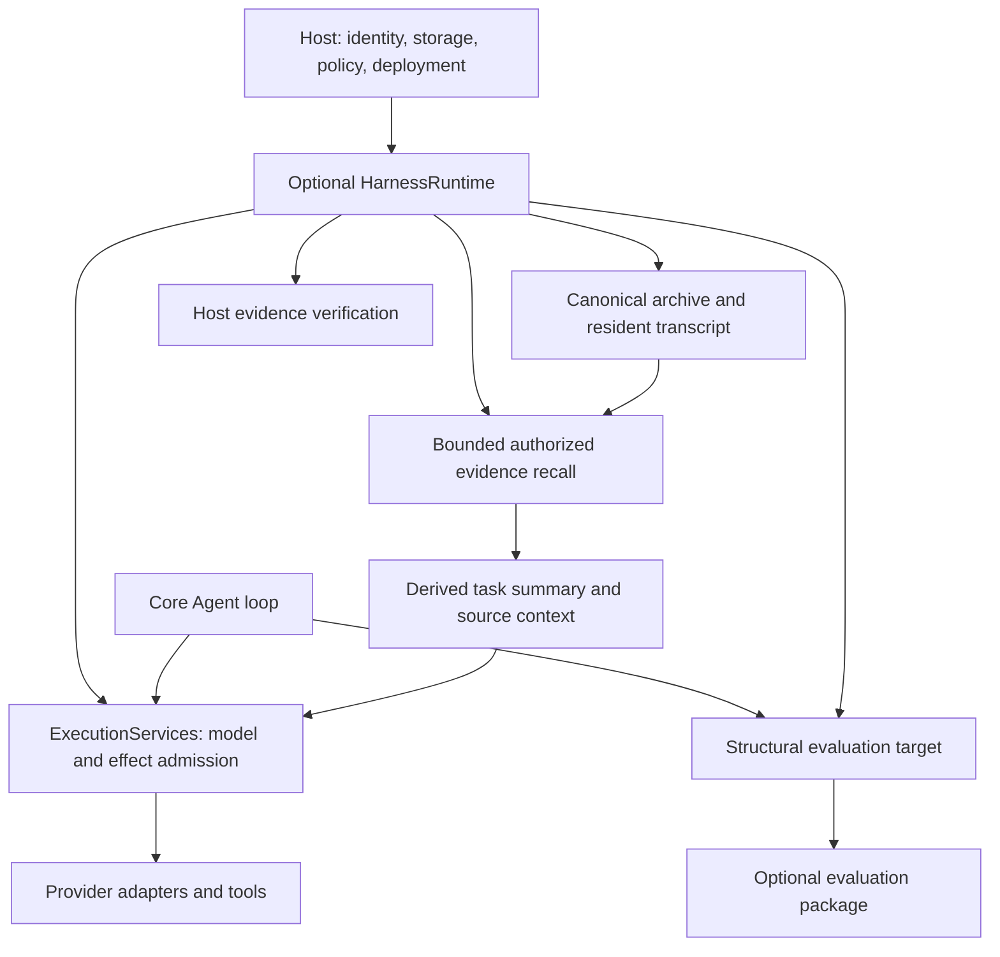

# Agentium core and harness dependability — proposed design

**Status:** Review draft, 2026-10-13. This document and its implementation plans are proposals, not approved or implemented changes. The user requested analysis/planning only, with parallel expert review. Existing working-tree changes are preserved.

**Repository baseline:** HEAD `c5f9b5249d299f5d2d39b74c87b83f0da7c15570`, package version `4.8.2`, plus the already implemented uncommitted host-controlled execution work. Read its [results](../host-controlled-execution/RESULTS.md) before implementing anything below. The findings in [the earlier SDK audit](../2026-10-10-sdk-audit/findings.md) are leads, not a second implementation specification; some are repaired or narrowed here.

## Purpose and architecture verdict

Preserve a small core execution loop, an optional harness governing its effects and lifecycle, and a host owning identity, credentials, storage, retention and deployment. This boundary is sound. Independent policies already justify the harness's explicit ports. The largest remaining risks are inconsistent execution/acknowledgement boundaries, incomplete context continuity, and accepted configuration or results which promise more than their implemented behavior.

The supplied harness architecture paper is a reference for component coverage and tradeoffs, not a performance ranking or mandate to reproduce a CLI. Its recommendations support explicit context policies, native provider capabilities, and verification before completion. They do not justify a universal workflow engine, mandatory graph database, hosted memory service, or protocol layer without a concrete consumer.

## Goals and success conditions

1. One authoritative terminal result follows provider/tool settlement and required persistence acknowledgement. Cancellation, truncation and missing terminal stream data cannot become ordinary successful completion.
2. Configured effect limits apply equally to ordinary and harness-controlled Agent execution, generate and stream. Preserve the possibility of a final answer call after the final permitted tool batch.
3. Namespace/scoped identity is injective. Persistent-key migrations are explicit and never use ambiguous fallback reads.
4. Parallel Workflow updates compose declared writes rather than overwrite with copied input; continuation checkpoints carry absolute cursor/version identity.
5. Every background summary/extraction has an owner and a bounded, truthful drain outcome. Closing a borrowed store remains a host operation.
6. Bounded recall discovers and reads relevant authorized evidence before configured task-model calls. An incremental summary identifies exactly which archived records it covers. Retrieval and summaries stay source data.
7. Completion may require host-verified tests/artifacts. Unknown evidence differs from failed evidence. Evaluations measure retrieval and answer use separately and preserve missing grades/infrastructure failures.
8. Plain Agent adoption stays simple. Advanced public APIs are additive, documented and exercised in packed ESM/CommonJS/TypeScript consumption.

## Capability map

| Id | Responsibility | Prerequisites |
|---|---|---|
| execution-integrity (M1) | Core loop boundaries; awaited harness lease operations; incremental session high-water recovery; legacy budget honesty | Existing host-control baseline |
| storage-identities (M2) | In-memory namespace separation; explicit v1 scope/Redis encoding and migration | Baseline |
| memory-lifecycle (M3) | Track/drain old memory work; coherent source wrappers; truthful write result | Baseline; M1 terminal conventions |
| workflow-state (M4) | Patch merge, cursor versions, failure/cancellation policies; Team handoff contract honesty | M1 |
| context-continuity (M5) | Bounded scope-authorized discovery/excerpt reads; incremental summaries; source revisions and uncertainty | M1; M2 for SDK-scoped backing stores |
| completion-evaluation (M6) | Deterministic evidence gate, structural EvalTarget, retrieval/answer measurement | M1; M5 for memory scenarios |
| supported-journeys (M7) | Coherent guides, exports, examples, declarations, consumer verification | Each relevant capability |

These are reviewable milestones. M2/M3/M4 can proceed independently after shared contracts stabilize. M7 documentation and consumer checks accompany each milestone; its final task assembles the journeys.

## Ownership and data flow

The arrows describe contracts. They do not imply remote policy interception, database permissions, durable recovery or a dependency from core/harness to eval. Host archive and recall implementations may share storage but have different APIs.

### Existing behavior to retain

- Provider retry ownership and deadline controls; never replay an established stream.
- Logical-call/token reservations, unknown-usage charging, finishing capacity within total limits, and currency accounting remaining in core.
- Mandatory grants and effect policy, trusted driver/factory code, source/host instruction distinction, and opaque provider continuation validation.
- Full canonical archive retrieval and verified digests. Resident limits remain opt-in and retain intact live turns. Archive acknowledgement precedes eviction.
- Live correlated input through existing `requestInput`/`reply`; public stateless input validation cannot claim a pending request.
- Local/portable harness composition with approved runtime references; no credentials or executable callbacks recovered from portable JSON.
- Standalone Agent use, existing package names, optional peer dependencies, and `.js` source imports.

### New behavior and defaults

- Correctness repairs apply to ordinary execution paths too. Preserve existing retry defaults already documented by the host-control change.
- Existing Workflow failure behavior stays `continue` by default; add explicit `stop` and report aggregate outcome. Parallel joins apply returned patches. Same-key writes use declaration order by default, with optional strict `merge: "error"`; strict conflicts are fatal through nested groups. A resolved incomplete Agent output is an error step, with its partial output retained as evidence.
- Persistent key encodings remain legacy by default during additive rollout; new shared-host examples select v1. In-memory namespace separation is corrected immediately. A default change requires a major release/migration.
- Recall and incremental archival summaries are off unless configured. Their bounds are explicit positive configuration values. The default recall query is the latest real user input, with current session/user scope only. A host may explicitly authorize broader project/repository access.
- Default recall policy stops on backend failure or unresolved partial evidence; healthy absence is exposed and may continue with uncertainty. Hosts can override continuation/clarification policy explicitly. Cancellation always cancels the run.
- Summary work uses existing ordinary control-model budgets and bounded per-call input/output. The task call slot is reserved first. Tokens are reserved after projection as today, so auxiliary work can still cause task token admission failure; this limitation is visible, not a promise of a hard token floor.
- Existing stateless `summaryContextPolicy` remains usable; a new continuity recipe selects incremental summary plus recall. No automatic persistent fact promotion or background learning is added to controlled runs.
- `Agent.close` gains bounded memory drain and explicit busy/unfinished-work behavior. It cannot prove a remote callback stopped or safely close storage beneath pending writes.

## Memory classes and lifecycle

| Class | Authority and lifecycle |
|---|---|
| Canonical transcript/archive | Faithful original records under host access/retention. Content may be obsolete or wrong. Integrity does not imply factual truth. |
| Task summary | Derived, rebuildable source context with explicit coverage, evidence references, derivation/policy version and uncertainty. |
| Persistent scoped facts | Later optional records: stated/inferred origin, independent verification status, effective interval, correction/supersession and source evidence. |
| Episodes | Later optional descriptions of a particular experience; never automatically generalized into requirements. |

Recording time and effective time differ. A new ingestion timestamp does not resolve a conflict or broaden scope. Source revision/locator and host view invalidation fence govern whether derived data is usable. SDK current-view fences reject stale summary reuse. Preventing physical late persisted copies after deletion completion requires the host conditional-publication/invalidation guarantee; independent read fences do not establish it. Backup deletion SLA and allowed retention exceptions remain host decisions.

## Compatibility and explicit limits

Additive types/configuration keep existing methods and defaults unless a documented correctness repair changes observable false-success/over-limit behavior. Keep `HarnessSessionLease.read()` synchronous: a remote store preloads its snapshot during awaited `acquire`. Widen only `commit` and `release` to accept void or Promise; all runtime callers await them. An attempted commit with unknown acknowledgement is not retried blindly in cleanup.

Do not promise distributed ownership from per-instance locks or generic KV. Repair loose-log recovery now; an optional atomic session capability is a later design track with explicit idempotency/revision requirements. Session durability remains separate from durable active-run recovery.

Do not claim full replay, exactly-once tools, filesystem rollback, hard physical-token ceilings, or forced termination of arbitrary JavaScript. A resumed procedural Workflow may execute a side effect again unless the host's operation is idempotent or reconciled. New strict continuation rejects ambiguous legacy checkpoints. Existing `replay` receives the cursor correction and a deprecation; removing its legacy acceptance requires a major-version migration decision.

## Deferred/gated work

Persistent fact promotion/storage adapters, durable active-run checkpoints and effect ledger recovery, public native-client customization, global registry default changes, generic lexical corpus/index persistence, skill paging, ACP hosting and broad package splits remain separate evidence-driven work. GraphRAG's generated raw query authority is a confirmed conditional risk and gets a separately gated read-only contract track; do not disguise a prompt rule or READ routing mode as database enforcement.

## Verification policy

Use current Vitest fixtures and deterministic failure injection before implementation; proposed tests must first fail for the intended public behavior. The plan includes commands from repository scripts. Previous checks on 2026-10-12 passed 2,448 tests (27 skipped), all workspace builds, core/harness declaration checks and package consumption. Those are historical baseline evidence; they do not validate proposed APIs or later source changes.

No new test/build/evaluation suite is run as part of this planning task. No live provider spend, external effects, migrations, publication, or source changes are authorized. Later release review records exact revision, commands, skips/unknowns and packed artifact compatibility. Fixture tests prove covered invariants; model-quality claims require the separately bounded evaluation protocol.
