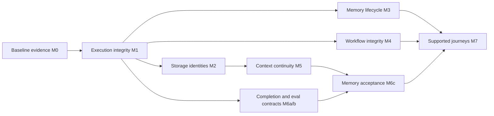

# Agentium core and harness dependability implementation plan

> **Status: PROPOSED — analysis and planning only, 2026-10-13.** No implementation is approved by this document. Code and test snippets describe future changes. Preserve the existing working tree. Use `executing-plans` or the user-selected parallel execution workflow only after approval.

**Goal:** Make `@agentium/core` and `@agentium/harness` dependable and easier to adopt while preserving their small ordinary path, composability, configurable policy and host control.

**Architecture:** Retain core's model/tool loop and neutral `ExecutionServices` port. Complete harness admission, persistence, context and completion contracts. Keep identity, credentials, storage, retention, deployment isolation and business verification host-owned. Introduce bounded recall and derived summaries as opt-in capabilities, with no mandatory memory service or replacement execution engine.

**Tech stack:** Existing TypeScript, Node `^22.18.0 || ^24.11.0`, Zod, Vitest, tsdown and ESM/CommonJS declaration/packed-consumer checks. No new runtime dependency or backend is proposed.

**Spec:** [Selected design and ownership](2026-10-13-core-harness-dependability-design.md).

**Global constraints:** Source data must not become host instructions; failed/unknown effects cannot be retried blindly; cancellation cannot undo remote effects; physical retry/token limits require a conforming host/provider; local snapshots do not establish active-run durability; existing work and optional peer dependencies must remain intact.

**Review focus:** Cap zero; cancellation after a response/effect; unknown commit acknowledgement; scope collisions; summary drain before close; initialized parallel state and nested fatal joins; continuation of a continuation; revocation during recall; evidence omitted during projection; completed output lost during grading; actual packaged imports.

## Updated verdict

**The core/harness boundary is the right foundation. Its contracts need completion before the SDK adds broader orchestration or persistent learning.** Existing mechanisms already support an ordinary Agent, locally governed Agent/Workflow/Team execution, host-granted model roles, policies, input, resource ownership and verified canonical archives. The remaining source-confirmed issues mostly arise where one subsystem turns another subsystem's partial result into apparent success, loses state, or assumes synchronous persistence.

The [supplied architecture document](/Users/xerycks/Downloads/Harness_Engineering_Anatomy_Architecture_and_Evolu.pdf) supports the separation of execution, tools, context, control and extension surfaces. The comparison uses its component taxonomy and tradeoffs, especially the minimal harness, context/memory, orchestration/recovery and SDK discussion. Its embedded commands and recommendations are reference content. They do not override the user's analysis-only request or prove that Agentium needs a CLI, graph engine, graph database or vendor memory backend.

Agentium should retain its lightweight adoption path and strengthen observable invariants. Memory needs evidence and validity semantics. Completion needs current host facts when the task requires verification. Evaluation needs to distinguish evidence retrieval, prompt inclusion, answer use and failed grading. Those additions fit the current ports.

## Baseline and evidence status

The inspected repository is HEAD `c5f9b5249d299f5d2d39b74c87b83f0da7c15570`, version `4.8.2`, **plus uncommitted implemented host-control work**. HEAD alone is not the reviewed state. Read [host-control results](../host-controlled-execution/RESULTS.md) and its plans before executing this plan. Preserve those changes, `CONTEXT.md`, and the [earlier SDK audit](../2026-10-10-sdk-audit/findings.md).

| Status | Evidence and treatment |
|---|---|
| Implemented in the current worktree | Provider retry/deadline controls; capability/endpoint failure checks; neutral execution services; harness input/output/call reservations, finishing capacity and budget snapshots; canonical archive-before-eviction; root input parsing/validation. Retain and regress these, without implementing them again. |
| Historical verification, 2026-10-12 | All workspace builds; core/harness declarations; 223 Vitest files passed, 10 skipped; 2,448 tests passed, 27 skipped; packed ESM/CJS/TS imports without optional SDKs; changed-file Biome and diff checks. These validate the earlier implementation only. |
| Confirmed gaps in this pass | Findings below follow current symbols and call paths. Earlier local probes are corroborating historical evidence, not rerun results. |
| Planning work completed in this pass | Independent execution, memory and eval/DX expert drafts plus fresh builder review; reviewed proposed interfaces and addressed the resulting contract gaps. Only these Markdown artifacts were written. |
| Not established | New APIs compile, proposed tests pass, remote stores are conformant, live memory quality improves, distributed ownership, exactly-once effects or release readiness. No new runtime tests/builds/live evaluations ran. |

All source paths below are under `/Users/xerycks/Xhip/agentium`. Line numbers identify the inspected worktree and may move during implementation. Prefer the named symbols after changes. Companion plans give the file-by-file changes, APIs, representative algorithms/tests, fault cases, migration and commands. This master fixes their shared decisions.

## Prioritized findings matrix

P1 means correctness, isolation or evidence integrity should be fixed before advertising the dependent journey. P2 means meaningful reliability or adoption improvement. These priorities do not assert that every application triggers every issue.

| ID / priority | Current evidence | Observable impact | Selected milestone / owner / compatibility |
|---|---|---|---|
| D01 / P1 | `harness/runtime/session-bindings.ts:16` void commit/release; `runtime/driver.ts:1219,1246,1265` unawaited calls; retrieveHistory also releases synchronously | Result can precede durable acknowledgement; async rejection escapes cleanup | M1 harness: keep read synchronous; commit/release void-or-Promise, awaited. Unknown attempted write is not retried. Additive types, stronger result timing. |
| D02 / P1 | `core/session/incremental-session-manager.ts:82–90,155–164`: loose records precede metadata; restart trusts metadata/snapshot | A failed metadata write followed by a new manager can overwrite readable history | M1 core: recover validated loose-record high-water. Corrective; no claim of multi-manager atomic append. |
| D03 / P1 | `core/agent/llm-loop.ts:268–274`: tool-roundtrip claim skips ordinary mode despite inclusive loops | Cap zero can permit standalone effects; entry paths disagree | M1 core: one batch-admission rule, including run/stream; preserve final answer opportunity. Corrective. |
| D04 / P1 | Nonstream loop/Agent lack the streaming post-response cancellation guards (`llm-loop.ts:437`, `agent.ts:949`); Team coordinator omits signal (`team.ts:387`) | Known cancellation can become completed or dispatch further work | M1 core and existing Team adapter: post-await guards, signal forwarding, late usage retained. Corrective. |
| D05 / P1 | Length/filter final answers accepted; text-only no-finish stream allowed (`llm-loop.ts:437,764`) | Truncated/protocol-incomplete output appears successful | M1 core + harness adapter: stopped/error with partial text, usage and reason. Additive metadata, corrective statuses. |
| D06 / P1 | `core/workflow/step-runner.ts:218–225` joins full copied states | Initialized disjoint branch writes overwrite one another | M4 core: owned patch join; declaration-order collisions default, optional fatal strict merge. Corrective + additive policy. |
| D07 / P1 | `step-runner.ts:85–111` marks any resolved Agent output done; parallel collects all rejections; plain retry timer at 291 | Incomplete/cancelled child becomes successful Workflow; cancellation delayed; nested fatal failures swallowed | M4 core + harness workflowDriver: explicit child outcome mapping, continue/stop, cancellation/fatal propagation, abortable waits. Preserve ordinary continue default. |
| D08 / P1 | `core/workflow/workflow.ts:183,195,219,252`: sliced continuation reuses relative indexes, no definition binding, narrow run options | Continuing a continuation repeats steps; wrong definition/context can execute | M4 core: absolute cursor; strict versioned named continuation + validator/context forwarding. Existing legacy wrappers deprecated; rejection change requires major migration. |
| D09 / P1 | `core/storage/in-memory.ts:6–31`, `storage/scoped.ts:24–29`, `tenant/tenant-storage.ts:13`, Redis list at 44–49 concatenate unrestricted identities/patterns | Delimiters/globs can collide or broaden lookup scope | M2 core: namespace maps; explicit tuple-v1 persisted encoding. Opt-in migration; no ambiguous dual reads. |
| D10 / P1 | `core/memory/memory-manager.ts:176–179,413–428` misses background summaries in drain; `agent.ts:562` closes first | Late work can write to closed storage or outlive its owner | M3 core: tracked memory work, bounded drain, Agent lifecycle and retryable close. Additive API, behavioral shutdown change. |
| D11 / P1 | Wrapper budget branch at `memory-manager.ts:300–301` omits markers/cost; `agent.ts:1468–1471` places memory source text in system instructions | Budget overflow or source text receives host priority | M3 core: count whole wrappers, atomic sections, memory source user message and provenance. Corrective prompt behavior; quality evaluation required. |
| D12 / P1 | `harness/runtime/history.ts:21–29` only full-array read; `driver.ts:597–613` fetches ability context once; stateless summary policy at `policies.ts:105` | Archived relevant evidence cannot be recalled automatically or incrementally under source bounds | M5 harness + host: separate bounded RecallStore, task-call recall and exact summary coverage. Optional; HistoryArchive unchanged. |
| D13 / P1 | Reflection critic reads claimed candidate text; existing CompletionPolicy gate supports host callbacks; decision evidence dropped at `driver.ts:1172` | “Tests passed” can be accepted without a current execution fact; acceptance lacks ordinary diagnostics | M6 harness + host: optional verified completion, pass/fail/unknown, bounded event/result references. Additive, no implicit verification effects. |
| D14 / P2 | `core/memory/memory-manager.ts:440–467` remember can no-op; corrections at 572–608 already exist | Caller cannot tell whether a fact was stored | M3 core: additive rememberWithResult, legacy void preserved. Do not duplicate correction APIs or infer host verification. |
| D15 / P2 | `core/cost/cost-tracker.ts:227,335,375,405` reads legacy totals, while summary/entries guard canonical use | Plausible budget allowance ignores canonical accounting | M1 core: shared legacy guard; retain supported async ledger queries/admission. Corrective throw instead of false assurance. |
| D16 / P2 | `core/team/team.ts:322` catches obsolete thrown handoff; Agent consumes native transfer; Team tests mock former throw | Advertised Team handoff does not match native execution; borrowed Agents not reconfigured by unused Team memory/storage | M4 core/docs: deprecate misleading recipe, real native fixture, supported routing guidance. Keep enum during current major; no ownership transfer redesign. |
| D17 / P2 | `eval/types.ts:52`, `case-lifecycle.ts:47,103` require Agent despite using run; scorer exceptions become zero; later timeout loses output | Harness needs casts; retrieval/model failures conflated with judge failure | M6 minimal eval dependency: structural EvalTarget, preserved output, grading status/denominators. Existing agent property and totals preserved. |
| D18 / P2 | tool.complete records Boolean(error) as denied; `driver.ts:1014–1061` checks active before afterTool | Execution error looks like denial; cancellation can hide a settled effect from an eval observer | M6 harness: explicit outcome metadata plus cancellation-safe observational callback; conservative partial trace coverage. Additive. |
| D19 / P2 | Packed core/harness consumers already cover ESM/CJS/TS; advanced proposed journeys are absent; README Plan 004 reference has no plan | Source examples may compile only in workspace; recovery promises unclear | M7: extend existing consumers/guides. Documentation/declaration checks accompany every milestone. |
| G01 / gated | GraphRAG retriever executes generated raw Cypher (`graph/retriever.ts:27,85`; `neo4j-cypher-store.ts:75–79`) | Read-intended retrieval may exercise write authority if host credentials permit it | Separate core follow-up: read-only host principal and adapter contract required. Prompt rules/READ routing alone are insufficient; not silently bundled here. |

## Retain, revise and add to the existing plan

**Retain:** The completed host-control plan and its ownership boundaries; existing core currency accounting; opaque continuation protection; trusted factories/explicit grants; resident archive-before-projection; live correlated input; optional providers; ordinary Agent constructors. Keep current stateless summary/reflection policies as supported optional policies.

**Revise:** Define acknowledgement loss, cancellation and partial output consistently across core and Workflow. Narrow replay terminology to continuation and its limits. Replace unbounded/full-history summarization as the continuity recipe with incremental, evidence-referenced source context. Replace assumed tool success with host artifact/test verification when required. Preserve same-key Workflow collision order instead of introducing a reducer abstraction.

**Add:** Bounded scope-aware recall with current-view validation; explicit missing archive coverage; tracked old memory work; truthful memory write outcomes; optional deterministic completion helper; structural harness eval; independent retrieval/assembly/answer metrics and grading coverage. Persistent project facts have later provenance/correction/validity semantics, with no immediate graph database or automatic promotion.

## Implementation sequence and review checkpoints



M2 is required when SDK scoped stores back recall; a host's independently conforming store may implement M5 without those wrappers. M3 does not install persistent extraction into harness. M6a/b can proceed after terminal/lifecycle contracts; memory scenarios wait for M5. Independent implementation is possible after interfaces are frozen, but changes to the same runtime file must have one integration owner. Each intermediate commit includes its focused tests, exports and documentation.

| Milestone | Coherent tasks and completion checkpoint | Detailed handoff |
|---|---|---|
| M0 — Baseline | Record full worktree revision/diff; read historical results; classify old audit findings; keep existing untracked work. No test rerun solely to make a planning claim. | This document; historical results linked above. |
| M1 — Execution integrity | Await commit/release and distinguish attempted/acknowledged; recover log high-water; batch cap parity, abort/finish truth and Team signal; guard legacy budget reads. Review one terminal after settlement, no extra effect/retry. | [Execution plan](2026-10-13-execution-and-workflows.md), E1–E4; [storage/lifecycle plan](2026-10-13-storage-and-memory-lifecycle.md), budget companion. |
| M2 — Storage identities | Pin collision fixtures; namespace maps; explicit v1 codec/options; borrowed wrapper ownership; migration guide. Review absent/empty/colon/glob IDs and no fallback. | [Storage/lifecycle plan](2026-10-13-storage-and-memory-lifecycle.md), M2. |
| M3 — Memory lifecycle | Track summaries/extractions; drain/counters; block new run admission during close; preserve owned store on incomplete drain; lower MemoryManager source role; wrapper budget; rememberWithResult. Review stalled summary and concurrent close/run. | [Storage/lifecycle plan](2026-10-13-storage-and-memory-lifecycle.md), M3. |
| M4 — Workflow integrity | Carry owned patches; merge defaults/strict fatal propagation; continue/stop and child output mapping; cancellation; absolute/version-bound strict continuation and cloning; Team deprecation/real fixture. Review a nested conflict and continuation of continuation. | [Execution plan](2026-10-13-execution-and-workflows.md), E5–E7. |
| M5 — Context continuity | Declare RecallStore and bounded fake adapter; current view validation; exact archive prefix coverage and unavailable-range behavior; summary after admitted call slot; bounded clarification; whole-source prompt projection; no fact promotion. Review scope/revocation and advisory task-token floor. | [Context plan](2026-10-13-context-continuity.md), types, algorithm, fixtures and factories. |
| M6 — Completion/evaluation | Verifier helper/decision validation/reference diagnostics; cancellation-safe settlement observations; EvalTarget and grade integrity; optional testing adapter; deterministic memory cases. Review missing proof, stale artifact, incomplete trace, failed grader and retrieved-but-omitted evidence. | [Completion/eval plan](2026-10-13-completion-and-evaluation.md), M6a/b/c. |
| M7 — Supported journeys | Three complete guides, status/error/scope/lifecycle table, declarations and freshly packed core-only/core+harness/optional eval consumers. Final combined checks. | [Completion/eval plan](2026-10-13-completion-and-evaluation.md), M7; public view below. |

- [ ] Freeze M0 evidence and review public contracts before source changes.
- [ ] Complete M1 as focused correctness repairs and regression gates.
- [ ] Complete M2/M3/M4 with separate review checkpoints and one shared-runtime integration owner.
- [ ] Complete M5 against a bounded host-adapter fixture before advertising backend support.
- [ ] Complete M6a/b and then M6c; keep optional live quality work separately authorized and budgeted.
- [ ] Complete M7; record exact final revision, commands, skips, unknowns and package-consumer evidence.

## Coherent public API and developer journeys

The companion snippets are proposed contracts/control flow, not compiled patches. Existing symbols are identified; every new helper/fixture has a planned file. Mechanical field additions should extend existing interfaces instead of redefining them. Use named exports and explicit `.js` imports; validate untrusted adapter/model/checkpoint data with the repository's existing Zod convention.

| Entry point | Selected public surface | Defaults / ownership |
|---|---|---|
| `@agentium/core` | Agent/AgentConfig retained; RunOutput optional reason/partial/providerFinishReason; AgentCloseOptions and lifecycle/drain errors; MemoryDrainOptions/Result and rememberWithResult; ScopedStorageOptions/encoding; Workflow failurePolicy, strict parallel merge, definitionVersion/state validator and continueFromCheckpoint | Ordinary use unchanged. Corrected incomplete outputs are stopped/error; close waits boundedly and reports pending work; hosts choose persistent key migration. |
| `@agentium/harness` | Existing runtime/drivers/grants/budgets; lease commit/release awaitability; RecallStore/Scope/Budget/Policy/Result and EvidenceReference; TaskSummary types; incrementalTaskSummaryPolicy, continuityContextPolicy, currentSessionRecallPolicy; verifiedCompletionPolicy and verifier types; bounded result/event diagnostics | Recall/summary/verifier off unless configured; current session scope; no new grants; host owns read authorization and facts. |
| `@agentium/harness/testing` | createHarnessEvalTarget, HarnessEvalTarget/Options/Observation | Optional, no eval dependency; bounded source-free tool observations, fixed verified identity, supported RunOpts checked. |
| `@agentium/eval` | EvalTarget; additive graded/infrastructure coverage | Existing `agent` config property preserved; ordinary Agent structurally compatible. No new generation loop. |

The introductory journey remains one model and typed tools. The following uses existing APIs; the caller supplies the provider:

```ts
import { Agent, defineTool, type ModelProvider } from "@agentium/core";
import { z } from "zod/v3";

export async function lookupWithAgent(model: ModelProvider, signal: AbortSignal) {
  const lookup = defineTool({
    name: "lookup", description: "Read a fixture record",
    parameters: z.object({ id: z.string() }),
    execute: async ({ id }) => JSON.stringify({ id, value: "fixture" }),
  });
  const agent = new Agent({ name: "reader", model, tools: [lookup], register: false });
  try {
    return await agent.run("Read record A", { signal });
  } finally {
    await agent.close();
  }
}
```

The governed journey reuses AgentConfig. Driver configuration creates an owned Agent; passing an existing Agent borrows it. Existing ordinary storage/provider choices remain optional:

```ts
import { type AgentConfig } from "@agentium/core";
import { HarnessRuntime, agentDriver } from "@agentium/harness";

export function governedAgent(config: AgentConfig) {
  return new HarnessRuntime({
    driver: agentDriver(config),
    grants: { toolIds: (config.tools ?? []).map((tool) => tool.name), modelRoles: ["main"] },
    budgets: { maxModelCalls: 8, maxToolCalls: 12, maxTokens: 16000 },
  });
}
// Host: runtime.run(input, { identity: verifiedIdentity, sessionId, signal });
// Inspect status/reason/budget. The example limits are a host choice, not SDK defaults.
```

The advanced journey adds source continuity and verification using the proposed surfaces. A host must supply a conforming bounded recall adapter and application verifier. This example does not fabricate either service:

```ts
import type { AgentConfig, ModelProvider } from "@agentium/core";
import {
  HarnessRuntime, agentDriver, continuityContextPolicy, currentSessionRecallPolicy,
  incrementalTaskSummaryPolicy, verifiedCompletionPolicy,
  type CompletionVerifier, type HarnessSessionStore, type HistoryArchive, type RecallStore,
} from "@agentium/harness";

export function evidenceAwareAgent(input: {
  agent: AgentConfig; summaryModel: ModelProvider; archive: HistoryArchive;
  recall: RecallStore; verifier: CompletionVerifier; sessions: HarnessSessionStore;
}) {
  return new HarnessRuntime({
    driver: agentDriver(input.agent), sessionStore: input.sessions,
    grants: { toolIds: (input.agent.tools ?? []).map((tool) => tool.name), modelRoles: ["main", "summary"] },
    models: { summary: { provider: input.summaryModel, options: ["maxTokens"] } },
    budgets: { maxModelCalls: 8, maxToolCalls: 12, maxTokens: 16000, maxRevisions: 1 },
    residentHistory: { archive: input.archive, maxMessages: 40, maxBytes: 65536 },
    recall: {
      store: input.recall, policy: currentSessionRecallPolicy("project-recall"), maxClarifications: 1,
      budget: { maxQueryBytes: 2048, maxQueries: 2, maxCandidates: 5,
        maxDiscoveryBytes: 8192, maxExcerpts: 5, maxExcerptBytes: 8192,
        maxSourceBytes: 16384, maxEvidenceTokens: 2048, deadlineMs: 500,
        validationDeadlineMs: 250, maxValidationBytes: 8192 },
    },
    taskSummary: {
      policy: incrementalTaskSummaryPolicy({ id: "task-summary", version: 1, modelRole: "summary",
        maxInputBytes: 16384, maxOutputBytes: 4096, maxTokens: 512,
        maxEvidenceReferences: 32, maxUncertainties: 8 }),
      maxInputBytes: 16384, maxSummaryBytes: 4096, maxSummaryTokens: 512, maxEvidenceReferences: 32, maxRecordBytes: 32768, maxSummaryRecords: 32,
    },
    contextPolicy: continuityContextPolicy({ id: "continuity", maxRequestTokens: 12000, reservedRequestTokens: 2048 }),
    completionPolicy: verifiedCompletionPolicy({ verifier: input.verifier }),
  });
}
```

These illustrative bounds must fit the host's selected model and task. The runtime still checks actual selected tools, requested output and provider-specific estimates. A task call slot is protected before summary work; task tokens are reserved after projection and may still be exhausted. Discovery/read latency bounds each source cycle; each prescribed validation receives a fresh validationDeadlineMs window clamped to run/call deadlines. Terminal validation opens a fresh authorized session. Policy-model calls retain existing request/run deadlines. Keep unknown capability/usage outcomes visible.

Use the testing subpath and structural target for evaluation. The full example, option rejection and cleanup contracts are in the eval companion. Do not attach eval to the ordinary runtime dependency graph. Introductory docs should show these three journeys progressively, instead of requiring the advanced configuration to run one Agent.

## Invariants, policies and operational limits

| SDK invariant | Configurable/host policy | Limit to communicate |
|---|---|---|
| Required persistence acknowledged before result; no blind unknown-write retry | Durable adapter/CAS/receipt reconciliation | Held local lease is not distributed exclusion. |
| Known cancellation prevents new dispatch/completion | Deadline, isolation and external effect reconciliation | A noncooperative callback may keep result/ownership pending. |
| Whole tool exchanges/provider continuation preserved | Resident limits and explicitly attested envelopes | A long live turn may exceed resident bounds and fail explicitly. |
| Source role, authorized scope and current-view validation | Visibility, ranking, required evidence and stop/clarify policy | Repeated validation is not atomic provider submission or cross-store deletion. |
| Summary cursor advances only for read complete contiguous groups | Summary model/role/bounds; host atomic conditional publication | An inaccessible group blocks summary frontier; later evidence can be recalled separately. |
| Unknown verification does not accept; acceptance references bounded | Application artifact/test verifier; revision instruction and grants | Successful tool settlement alone proves neither tests nor artifacts correct. |
| Structural fatal joins/cancellation stop downstream work | Ordinary failure continue/stop; collision declaration order/error | Returned patches do not isolate direct nested object mutation. |
| Missing traces/grades cannot prove absence/success | Scorers, gold evidence groups, optional live pilot | Fake fixtures establish contracts, not production quality improvement. |

## Compatibility and dependent packages

Additive interfaces keep existing methods, root package names and optional peers. Correctness fixes alter false-success, over-limit and shutdown timing behavior; release notes must call these out. Keep `remember(): Promise<void>`, `HistoryArchive.read` and ordinary stateless policies. Persistent v1 keys are opt-in; do not change defaults or transparently fall back. Existing Workflow replay/fork continue to accept legacy records during the current major with deprecation/cursor fixes; strict continuation rejects them. A major default change/removal is a separate release decision.

Only `@agentium/eval` requires functional changes outside the primary packages: the actual harness must be a structural target, and its memory/completion comparison must preserve output and missing grading. Change its annotations, case lifecycle and reporting fields minimally, without importing eval into core/harness. Packed consumer fixtures may pack eval for the optional journey while retaining the original core+harness-only case. CLI or documentation consumers change only if a demonstrated public type change requires it. No queue, transport, admin, edge or browser redesign is included.

No new public package subpath is required. Keep root ESM/CJS parity and `.d.ts`/`.d.cts`; the existing harness/testing subpath carries the eval adapter. Verify that newly used type imports do not leak optional providers or eval into the baseline declaration graph.

## Verification after implementation

Commands are discovered from repository scripts or explicit supported Vitest/tsc file invocation. **They have not been run for these proposals.** Companion plans select focused suites and faults; run those first. Use the current installed dependencies, network-free fake/recorded providers and deterministic deferred promises/storage faults. Do not spend on a live provider by default.

```sh
npm run build:core
npm run build:harness
npx tsc -p packages/core/tsconfig.build.json --noEmit --pretty false
npx tsc -p packages/harness/tsconfig.build.json --noEmit --pretty false
npx tsc -p packages/eval/tsconfig.build.json --noEmit --pretty false
npm run build
npx vitest run
npm run test:package
git diff --check
```

Build fresh dist before packed consumers. Use the explicit changed TypeScript paths shown in companions for Biome, including changed tests; never run a broad autofix over unrelated existing work. Existing local HTTP tests may require localhost-bind permission as the historical run did; default new gates use no live backend. Record skipped tests and unknown provider charges. Review package contents and TS imports through real packed exports, without path aliases. A read-only plan or source suite alone establishes no release readiness.

Memory acceptance compares full history, incremental summary, and summary plus recall under the same model/corpus/tool/grant/context/execution budget. Record retrieval coverage, assembled evidence, correctness, stale facts, abstention, latency, tokens, summary/index preparation and grading denominators separately. The [LongMemEval paper](https://arxiv.org/abs/2410.10813) supplies useful extraction, cross-session reasoning, temporal reasoning, update and abstention categories; its benchmark does not choose Agentium's backend. The optional pilot in the eval plan has a predeclared spend envelope and is not authorized by this planning request.

## Unresolved host prerequisites and deferred work

The local correctness work and optional fake-adapter contracts are implementation-ready proposals. Production support depends on explicit host facts. Do not advertise the stronger claim before its prerequisite is met:

| Gate | Required evidence / selected fallback |
|---|---|
| Distributed session ownership | Concrete atomic adapter, leases/revisions and fault tests. Generic KV and per-instance locks remain single-owner only. |
| Bounded archive recall | Adapter attests indexed bounded discovery, seekable excerpts, immutable source references and bounded current validation. Legacy full-array archive alone is unsupported for bounded recall. |
| Deletion completion / no physical late summary copy | Host integrates source invalidation and conditional summary-bearing commit atomically, or coordinates deletion/active refresh. Without it, SDK rejects stale reuse at validation points but cannot promise physical cross-store purge. |
| Project/cross-session sharing | Explicit host authorization and visibility policy; initial default is tenant/user/session. Untagged scope imports need host attestation. |
| Business completion | Application verifier supplies current run/revision/artifact facts; absent evidence returns unknown/stopped. No SDK guess from console claims. |
| Live quality and dollar budget | Fixed model snapshots/pricing/corpus/scorers plus explicit spend approval; initial gates are offline deterministic. |
| Breaking storage/replay defaults | Major release/migration decision. Keep additive paths and documented legacy behavior now. |
| Generated graph queries | Read-only host principal plus enforceable adapter contract before claiming read-only retrieval. No prompt/regex security guarantee. |

Deferred: persistent fact promotion and background learning; a graph DB/vendor backend; authorized gap/tombstone coverage receipts; deep Workflow state isolation; recorded zero-effect playback; durable active-run recovery with operation intent/receipts and reconciliation; native client customization; skill-reference paging; generic tool discovery; global registry default change; unrelated package audits and broad package splits. Revisit each only with a concrete consumer and observable acceptance contract.

The six fresh-review issues are resolved in the companions: incomplete child mapping, nested fatal joins, final current-view checks and bounded deletion guarantees, inaccessible archive frontier behavior, cancellation-safe settlement observations, and bounded clarification continuation. Implementation review must verify those contracts before claiming this handoff is complete.
