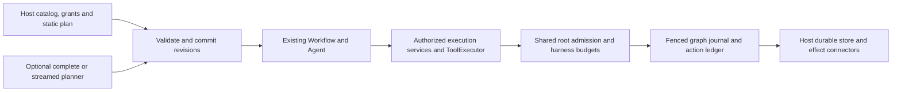

# Durable execution graphs: implemented and verified

Agentium now recovers unfinished execution graphs, including controlled function/tool nodes and restricted ordinary Agent nodes. Root concurrency and lifetime limits span nested graphs, repeats, Agent tool batches and planning. An optional model planner generates validated catalog DAGs. Streamed planning commits complete versioned proposals and can change only unclaimed pending topology.

All four requested capabilities are implemented. There are no open material review findings or required implementation blockers. Source commit **`a9b0d1ba903294963fb7a97d438cd46028e8d80a`** is on local branch **`agent/durable-execution-graphs`**, based on `e9551e3690bdf274fc66f82222851fe9d06d8e97`, in `/Users/xerycks/.codex/worktrees/core-harness-dependability/agentium`. Nothing was pushed, merged into main, published or deployed. No paid provider calls or external business effects were used. The original checkout remains independent; its concurrent changes were not imported or reset.

## Architecture and public use



The SDK owns contracts, validation, scheduling, counters and recovery protocol. The host owns executable versions, storage lifecycle, credentials, authenticated identity, receipts and destination reconciliation/idempotency. Existing Workflow/StepRunner/Agent/ToolExecutor, durable task stores, supervisor, action ledger and run records remain the foundations. No separate graph database, queue or third-party planner dependency was introduced.

| Public contract | Purpose |
| --- | --- |
| `ExecutionGraphRuntime` in `@agentium/harness` | `create`, `run`, read-only `inspect`, persisted `cancel`, storage/recovery capabilities |
| `ExecutionGraphProgram`, `ExecutionPlan`, `GraphBinding` | Versioned static/planner program, strict JSON proposal, host tool/Agent/graph/repeat catalog |
| `ExecutionGraphLimits` | Root concurrency/expansion/work/revision ceilings plus bounded plan validation |
| `validateExecutionPlan`, catalog descriptor/digest helpers | Full preflight without model or effect dispatch; bounded inherited depth |
| `RootExecutionController`, `RootExecutionLease`, counts/events/persistence in core | Shared FIFO admission and monotonic lifetime accounting; owned stream cleanup |
| `DurableGraphJournal` in core | Fenced plans, node/model attempts and outputs, repeat decisions, budgets and effect evidence |
| Additive `ExecutionServices.invokeTool`/`rootExecution` | Authorized post-validation interception including Agent-local tools |

The [packaged execution-graph guide](../../packages/harness/EXECUTION-GRAPHS.md) contains a complete compiled and executed public static example, reference syntax, recovery binding requirements, planner settings and NDJSON frames. A program chooses exactly one of `plan` or `planner`; a node selects only a catalog binding ID/version and JSON arguments. An abbreviated plan is:

```ts
{ schemaVersion: 1, revision: 1, nodes: [
  { id: "result", binding: "echo", version: "1", args: { value: "hello" } },
] }
```

## Recovery and effect semantics

The task pins manifest/catalog/program/binding identity, original input, policy/grants, budgets and absolute deadline. Plain programs, nested templates, limits and policy configuration are copied at construction. Opaque schemas/providers/Agent instances and callback implementations remain host-attested by version. Descriptor changes fail before resumed work.

Materialized revisions and node incarnations have stable IDs. Node inputs, outputs and attempts carry digests and worker fences. Completion persists before successors. Completed nodes replay their outputs; interrupted running work restarts under a newer fence; failed/cancelled work remains terminal. Repeat guards and materializations are retained. Inspecting state neither claims ownership nor mutates a task.

Agent nodes restart from node entry using request-bound complete recorded model responses and stable tool-call IDs. Approved tools are reauthorized before replay. Confirmed raw outputs/receipts are reused without a new dispatch attempt or duplicate logical tool charge. An interrupted model reservation remains conservatively charged; budgets and deadlines never replenish on recovery. Unsupported dynamic hooks, memory, handoffs, unbounded model outputs, caches, output transforms and non-JSON/opaque continuation fail preflight.

An effect binds the node incarnation, call, binding/version and parsed arguments, plus policy/grants/identity. Append-only origin evidence selects the exact originating operation for reconciliation, even if two connectors share destination/version. Root admission occurs while the action is prepared, before remote dispatch is recorded as executing. Local admission failure stays known not dispatched. The permit spans dispatch and receipt settlement. Confirmed replay/reconciliation needs no fresh dispatch allowance.

Acceptance followed by process death before receipt persistence requires confirmed reconciliation, proven absence/destination idempotency, or explicit `DurableRecoveryRequiredError`. Missing/transient evidence cannot justify unsafe redispatch. Fenced workers cannot settle current nodes, but physical late remote work may still finish and retain its destination receipt. **There is no exactly-once external-execution or remote-rollback guarantee.**

## Scheduling and planning semantics

One root slot covers an actual provider request/stream or controlled tool/function callback. Graph/repeat/Agent containers hold no slot while waiting for children, so capacity one completes without a parent-child deadlock. Nested controlled dispatch inside a leaf is rejected. Streams retain their slot until closure; already-owned cleanup can run after cancellation while preserving nesting/ownership guards. FIFO queue cancellation and deadline checks stop further admission.

`maxExpandedNodes` counts unique materialized incarnations, including pending replacements. `maxWorkAttempts` counts fresh leaf dispatches. `maxPlanRevisions` counts revision admissions across all episodes. These monotonic counters supplement model/tool/token/deadline budgets and persist before dispatch. Removed nodes and interrupted/conservative reservations do not refund allowances. Snapshot/admission events expose queue, active work and exhaustion. Providers retain ownership of transport retries; a controlled invocation is one work attempt.

The optional planner is tool-free and uses authorized harness model ports and shared budgets. System messages retain host instruction authority; catalog, input, retrieved/tool content and observations are source data. Validate complete proposals for identity, schemas, declared references, dependencies/cycles, bytes/nodes/cumulative depth/concurrency, revisions and supported effect policy. Record accepted/rejected proposals and causal diagnostics. Correction/fresh-call ownership is bounded across recovery; permanently exhausted invalid proposals fail with their cause.

Streams accept newline-terminated, complete self-contained `{baseRevision, plan}` frames. Fragments, unapproved operations and unresolved prerequisites never execute. Revision commit and node claim serialize under fenced CAS. Only unclaimed pending work may change; claimed/prepared/running/completed/failed/uncertain definitions and relevant edges are immutable. Replacement retains tombstones and spends new incarnation allowance. Old callbacks cannot execute superseded work; edits imply no rollback.

Producer and scheduler progress independently. A committed prefix can execute before the stream ends when capacity permits. Capacity one waits for the model slot without deadlock. Planning seals only after coherent terminal provider usage and EOF. Interrupted or malformed continuation retains accepted work and evidence but cannot report planning success. Recovery uses bounded continuation from the current revision; sealed records replay without another planning call. Byte/frame/latency/token/correction/depth/root/revision ceilings and the original deadline apply.

## Verification

All final gates passed on macOS arm64, Node `22.23.1`, npm `10.9.8`, Vitest `4.1.11`. The [gate manifest](evidence/gates.json), [798 source/package input hashes](evidence/final-source-state.json) and logs identify the verified payload. The fingerprint is `57e675a2b7ecbf3b0c285b9159d01482314fa18236aa1d0b5ac96da5d10fe4de`. Source/package inputs were verified unchanged after the source commit; report-only changes do not alter that fingerprint. Stored logs remove terminal styling and trailing whitespace. The large nested-graph RED assertion has a readable [excerpt](evidence/review-parent-red.log) and a [full original gzip](evidence/review-parent-red.full.log.gz); the excerpt records its uncompressed SHA-256.

| Check | Result | Evidence |
| --- | --- | --- |
| `npm run build` | All ten workspaces, exit 0 | [build](evidence/final-build.log) |
| `tsc -p <workspace>/tsconfig.json --noEmit --pretty false`, all workspaces | Source/test types, exit 0 | [types](evidence/final-types.log) |
| `npm test -- --maxWorkers=2` | 264 files / 3,035 passed; 11 files / 40 skipped | [full suite](evidence/final-tests.log) |
| `npx biome ci .` | 748 files; exit 0, one informational style diagnostic | [Biome](evidence/final-biome.log) |
| `npm run test:package` | Four tests; packed ESM/CJS, public TS/CTS, optional-peer absence and real graph execution | [packed](evidence/final-packages.log) |
| `node --test scripts/release-lock.test.mjs scripts/cjs-declarations.test.mjs` | Four passed | [metadata](evidence/final-metadata.log) |
| Strict NodeNext types + TSX execution of extracted guide | Expected completed echo result, exit 0 | [types](evidence/final-guide-types.log), [runtime](evidence/final-guide-runtime.log) |
| Enabled real Mongo suites | Five files / 28 passed, zero skips; 44.65 s | [Mongo](evidence/final-mongodb.log), [source hashes](evidence/final-mongodb-sources.json) |
| Matched offline evaluation | 12/12 cases; zero forbidden effects/dependency violations | [evaluation](evaluation.md), [JSON](evidence/evaluation.json) |
| Focused review/root/recovery regression suites | 102 passed | [review GREEN](evidence/review-green.log) |

The first full run, concurrent with other heavy gates, passed 3,034 tests but failed an existing 5 ms reliability-timeout assertion because its fake Agent had not started. The unchanged lifecycle can time out before microtask dispatch. The [failure](evidence/initial-tests-concurrent.log) remains retained. The unchanged [isolated suite](evidence/timeout-isolated.log) passed nine tests, and the entire suite passed with two workers. No evaluation source/test fix or relaxed assertion was introduced.

Default skips are explicit environment gates. Mongo and packed gates were enabled separately. Redis/Postgres, sandbox/native SDK and OTel external integration matrices were not run for this change; those implementations were not modified. No Node 24/Linux/remote CI, live-model quality, replica-set failover, power-loss or production deployment check is claimed.

### Actual persistent process-crash checks

MongoDB `8.0.1` ran as a task-owned loopback standalone with journaling, isolated fixture databases and an existing supported task adapter. The graph suite launched fresh TSX workers and used SIGKILL at persisted barriers. Its **11 cases** cover before dispatch, accepted-before-confirmation, confirmed-before-node-completion, completed siblings, real Agent decision replay, repeat decisions/iterations, stale fencing, unresolved missing receipts without redispatch, cancellation/deadline, exhausted retained tool budgets and unsealed streamed commits with bounded continuation. Destination counts, saved records, counters, order and receipts are inspected. Local mocks are not presented as process/backend evidence. The verified task-owned backend was [stopped after testing](evidence/backend-cleanup.json); its temporary data directory remains available, and no unrelated service was signalled.

```sh
AGENTIUM_DURABLE_MONGO_TEST=1 \
AGENTIUM_DURABLE_MONGO_URI='mongodb://127.0.0.1:27319/?directConnection=true' \
npx vitest run \
  packages/harness/src/runtime/__tests__/execution-graph.mongodb.test.ts \
  packages/core/src/durable/__tests__/mongodb.integration.test.ts \
  packages/core/src/durable/__tests__/records-mongodb.integration.test.ts \
  packages/harness/src/watch/__tests__/watch-mongodb.integration.test.ts \
  packages/transport/src/__tests__/durable-protocols.test.ts
```

### Independent review and corrections

The fresh [whole-change review and refresh](evidence/independent-review.md) found five original defects: dynamic depth bypass, mutable admitted configuration, ambiguous connector routing, skipped canceled stream cleanup, and admission refusal recorded as uncertain external work. All five were reproduced and corrected. The same reviewer independently repeated its original probes and found no remaining material finding. RED/GREEN and full/backend/packed gates cover the final source payload.

## Matched offline measurement

Four tasks ran under the same deterministic provider policy, tool implementations and resource ceilings in three modes. The scorer and canonical fixture plan did not change to accommodate failures. Tasks cover independent reads/join, a dependent chain, prerequisite failure and an unapproved mutation requested by untrusted content.

| Total across four tasks | Agent loop | Complete DAG | Streamed DAG |
| --- | ---: | ---: | ---: |
| Correct outcomes | 4/4 | 4/4 | 4/4 |
| Model calls | 11 | 4 | 4 |
| Approved tool dispatches | 7 | 7 | 7 |
| Generated synthetic tokens | 3,326 | 3,506 | 3,718 |
| Budget-charged tokens | 3,326 | 3,506 | 4,685 |
| Unknown-usage calls | 0 | 0 | 1 |
| Unapproved operations proposed / executed | 1 / 0 | 1 / 0 | 1 / 0 |
| Downstream dispatch after failed prerequisite | 0 | 0 | 0 |
| Aggregate local wall time | 30.8 ms | 152.8 ms | 195.2 ms |

The streamed invalid proposal lost the terminal usage event, so its allowance was conservatively charged. The DAG modes used fewer decisions but more synthetic tokens in this fixture. Tokens use the local fallback estimator and do not represent vendor billing; one local run without network delay does not establish production speed or live-model planning quality. The [evaluation report](evaluation.md) records matched caps, scoring, original failures, actual source hashes and reproduction command. Spend was zero paid calls and zero external effects.

## Compatibility, dependencies and remaining limits

No dependency, lockfile or package-version change was made. The harness package adds `EXECUTION-GRAPHS.md` to its packed files. Public contracts are additive and opt-in; ordinary Agent/Workflow/HarnessRuntime behavior and existing checkpoints remain compatible under the passing suites. The existing generic workflow driver still advertises non-durable execution. JavaScript consumers can inspect explicit durable-store capabilities; in-memory execution remains `durable:false`, and `requireDurable:true` rejects it.

Required capabilities are complete; no required piece is deferred. Deliberate supported-binding limits remain: stateless JSON recovery, explicit pure/effect declarations, versioned host executable implementations, bounded Agent outputs, and supported model continuation shapes. Providers/connectors must honor cooperative cancellation/timeouts. An SDK lease cannot preempt physical remote work. Storage uses one bounded task aggregate (Mongo default 2 MB), so retaining large histories can fail before further mutation; no recovery evidence is silently evicted. Production failover and live-provider evaluations require their own environment/authorization.

## Changed-file map

| Responsibility | Files |
| --- | --- |
| Public runtime, catalog and exports | [runtime](../../packages/harness/src/runtime/execution-graph.ts), [contracts](../../packages/harness/src/runtime/graph-contracts.ts), [harness exports](../../packages/harness/src/index.ts), [core exports](../../packages/core/src/index.ts) |
| Fenced journal, supervisor entry and origin/receipt ports | [journal](../../packages/core/src/workflow/durable-graph.ts), [supervisor](../../packages/core/src/durable/supervisor.ts), [recovery ports](../../packages/harness/src/runtime/graph-recovery.ts) |
| Root controller, Agent/Workflow/tool coverage | [controller](../../packages/core/src/agent/root-execution.ts), [Agent](../../packages/core/src/agent/agent.ts), [services](../../packages/core/src/agent/execution-services.ts), [ToolExecutor](../../packages/core/src/tools/tool-executor.ts), [StepRunner](../../packages/core/src/workflow/step-runner.ts) |
| Planner, validation and streamed revisions | [planner](../../packages/harness/src/runtime/execution-planner.ts), [proposal](../../packages/harness/src/runtime/execution-proposal.ts), [commit](../../packages/harness/src/runtime/plan-commit.ts), [stream parser](../../packages/harness/src/runtime/plan-stream.ts) |
| Retained model/tool/token accounting | [budget](../../packages/harness/src/runtime/budget.ts), [driver](../../packages/harness/src/runtime/driver.ts) |
| Recovery/crash/review/planning tests | [Mongo](../../packages/harness/src/runtime/__tests__/execution-graph.mongodb.test.ts), [fresh worker](../../packages/harness/src/runtime/__tests__/fixtures/graph-crash-worker.ts), [review regressions](../../packages/harness/src/runtime/__tests__/execution-graph.review.test.ts), [ports](../../packages/harness/src/runtime/__tests__/graph-recovery.test.ts), [planning integration](../../packages/harness/src/runtime/__tests__/execution-planning.integration.test.ts) |
| Public consumption and usage | [packed consumers](../../packages/harness/src/__tests__/package-consumption.test.ts), [packaged guide](../../packages/harness/EXECUTION-GRAPHS.md), [package metadata](../../packages/harness/package.json) |
| Design and evidence | [design](design.md), [completed plan](plan.md), [admission inventory](admission-inventory.md), [recovery inventory](recovery-inventory.md), [planner inventory](planner-inventory.md), [evaluation](evaluation.md), [gate manifest](evidence/gates.json), [original checkout audit](evidence/original-audit.json) |
