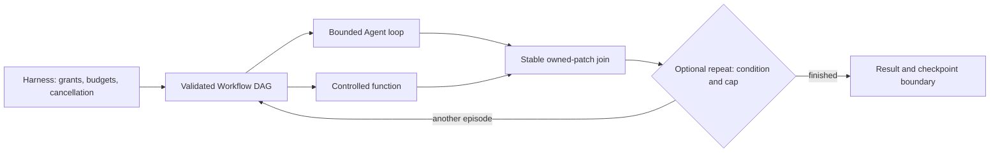

# Execution graphs: implemented and verified

Agentium now supports dependency graphs inside its existing Workflow API, with ordinary Agent loops and controlled functions as nodes. Ready nodes start as soon as their dependencies finish, within the graph's concurrency bound. An optional bounded repeat step can run another validated episode after observing the previous result. This adds explicit coordination while preserving the current harness, effect policy, shared budgets and evaluation adapters.

The implementation is complete on local branch `agent/execution-graphs` in `/Users/xerycks/.codex/worktrees/core-harness-dependability/agentium`. The verified source revision is `0fd732cda0fbf40472288e5b445f243149abeb1b`, based on `f5e4434723c33f2610416bee789c78bb32787315`. There are no unresolved material review findings or blocked implementation tasks in this change. The branch and managed checkout remain available; nothing was pushed, merged, published or deployed.

## Architecture and practical behavior

The chosen composition is an explicit workflow graph containing adaptive Agent nodes. Existing ToolExecutor already runs a model's independent tool batch concurrently, so the implementation does not add a second Agent planner or tool scheduler. The new graph is valuable when stages have declared dependencies, state ownership, branches or joins. A single existing Agent loop remains appropriate for exploratory work without those stage boundaries.

This decision follows the papers' execution patterns and Agentium's actual interfaces. ReAct supports local reasoning and action after observations. OpenHands separates agent decisions, event history and runtime execution. LLMCompiler separates dependency planning from readiness scheduling, allows tools that are agents, and replans between episodes. The choice to reuse Workflow, enforce owned patches and retain boundary checkpoints is engineering judgment; these papers do not establish Agentium's cancellation, retry, durability or effect guarantees. [ReAct v3, §2](https://arxiv.org/html/2210.03629v3#S2); [OpenHands v3, §§2.1–2.4](https://arxiv.org/html/2407.16741v3#S2); [LLMCompiler, §§3.1–3.3, p.4](https://raw.githubusercontent.com/mlresearch/v235/main/assets/kim24y/kim24y.pdf#page=4) and [§3.4, p.5](https://raw.githubusercontent.com/mlresearch/v235/main/assets/kim24y/kim24y.pdf#page=5).

The additive public contracts are [WorkflowGraphNode and GraphStep](../../packages/core/src/workflow/types.ts#L40) and [RepeatStep](../../packages/core/src/workflow/types.ts#L61):

- `dependsOn` controls ordering. A predecessor may finish done or skipped. `inputsFrom` also controls scheduling and supplies data; its producer must finish done. Failed or blocked predecessors block their consumers.
- Each node receives a structured clone of graph entry state plus patches from its transitive data ancestors. Completed siblings and control ancestors do not silently become inputs. Graph state and returned patches must be structured-cloneable.
- Complete episodes are validated before node dispatch: identifiers, step shapes, references, duplicate edges, mixed-edge cycles, limits and node counts. Identity validation includes well-formed Unicode before path encoding.
- Scheduling is incremental. In `A/B; C <- A; D <- A,B; E <- C,D`, C can start while B is still running. Results and joins use stable topological order with declaration-order ties, independent of settlement order.
- Strict merge is the default: incomparable nodes owning the same state key conflict, including equal-value writes. Ordered descendants may overwrite ancestor keys. The explicit `declaration_order` option uses stable topological order with declaration-order ties.
- Ordinary node failure retains child diagnostics and successful independent patches; its own patch is discarded and dependent work is blocked. Definition, merge and cancellation failures stop admission, drain started work and reject the boundary. Effects already executed are not rolled back.
- Graph defaults are five concurrent nodes and 100 nodes per episode. Repeat requires a positive safe integer cap, captured before callbacks run. It reports `workflow_iteration_limit` if the condition still requests work at that cap. Static and dynamic composition are depth-bounded.
- A graph factory inside a repeat selects the next episode from settled observations. Factories and predicates are trusted host callbacks; the SDK does not execute arbitrary model-generated code or provide an autonomous planner.
- Scoped paths identify nodes and iterations in results, events, effect names and Agent child sessions. Existing Agent output keys remain `<step.name>_output`. Node and tool content remains data under host instruction authority.

The harness integration also corrects an existing budget admission defect. Root `dispatch` and `dispatchEffect` previously passed distinct wrapper/underlying policy identities to ToolExecutor even though both delegated to one shared budget. One operation could consume two admissions, preventing an effect with an exact budget of one. Both ports now reuse `ctx.executionPolicy`; separate local-policy composition and host denial remain enforced. Four direct regression cases cover these behaviors. See [driver integration](../../packages/harness/src/runtime/driver.ts#L827) and [budget regressions](../../packages/harness/src/runtime/__tests__/controlled-effect-budget.test.ts).

## Verification

All final gates passed against the source revision above, on local macOS with Node `22.23.1` and npm `10.9.8`. The [gate manifest](evidence/gates.json), [source input hashes](evidence/final-source-state.json) and captured logs preserve the evidence. Stored logs normalize trailing whitespace only; original command logs remain in the ignored task scratch directory. The source input fingerprint is `fa19e233967e4ba395be0b0e26b3fba3136399358e01d3c2e1ed930a1bfb5d8c` over 749 tracked source, test, package, script and configuration inputs; report-only changes do not alter that fingerprint.

| Gate | Result | Evidence |
| --- | --- | --- |
| `npm run build` | All workspaces built, exit 0 | [build log](evidence/final-build.log) |
| `npm test` | 251 files / 2,818 tests passed; 10 files / 29 tests skipped | [test log](evidence/final-tests.log) |
| `npm run test:package` | 4 tests passed across 2 files; packed ESM/CJS and TS/CTS consumers | [package log](evidence/final-packages.log) |
| Source and test TypeScript checks | All ten workspaces passed | [type log](evidence/final-types.log) |
| `npx biome ci .` | 724 files checked, exit 0 | [Biome log](evidence/final-repository-biome.log) |
| Release-lock / CJS declaration metadata tests | 4 passed; their checked inputs unchanged since execution | [metadata log](evidence/final-metadata.log) |
| Strict documented-example and comparison-script types | Three guide examples and the script passed | [guide log](evidence/final-guide-types.log), [script log](evidence/final-script-types.log) |
| Final affected suite | 141 passed | [focused log](evidence/identity-green.log) |
| Final paired offline comparison | All 6 executions correct | [comparison JSON](evidence/final-comparison.json) |

The new suites contain 79 behavioral cases: 45 scheduler, 20 Workflow integration, ten real harness graph integrations and four direct effect-budget regressions. They cover concurrency, dependency readiness, branches and joins, transitive input isolation, conflicts, invalid definitions, repair limits, shared budget exhaustion, cancellation and draining, partial failures, retry ownership, instruction authority, scoped identity, completed-boundary checkpoint continuation and existing Agent callers. Packed tests check the built public surface rather than source-only imports. Extracted guide inputs are retained as `evidence/example-*.ts.txt` with [compiler settings](evidence/guide-tsconfig.json); empty successful TypeScript logs are expected.

No Node 24/Linux/remote CI run, live provider evaluation, database integration, sandbox/native SDK or OTel SDK integration matrix is claimed. Default environment-gated tests remained skipped; the four packed-consumer cases were run separately. Existing bundler warnings did not prevent a successful build. These checks verify this implementation and its covered contracts; they are not a package publication or deployment readiness decision.

## Independent review and corrections

The [historical independent review](evidence/final-review.md) examined the complete branch at `00665ee0898d252d76a952ebecd2bbec05fd304b` and reproduced three P2 defects with local source probes. The report remains unchanged so its original verdict and evidence are visible. The coordinator reproduced all three in failing regression tests, corrected them at `2896f397fd766fca9fafac0e4c249de36f10609f`, and verified the corrected revision. The reviewer did not independently rerun the final fixes or broad suite.

| Finding | Resolution | Regression |
| --- | --- | --- |
| F1: callbacks could mutate the validated repeat cap | Capture cap, predicate and body list before callbacks | [entry-bound test](../../packages/core/src/workflow/__tests__/execution-graphs.test.ts#L32) |
| F2: nested blocked paths acquired duplicate prefixes | Scope only results synthesized by the current scheduler; preserve already scoped children | [nested path test](../../packages/core/src/workflow/__tests__/execution-graphs.test.ts#L71) |
| F3: a later predicate exception dropped completed state/evidence | Preserve accumulated patch, state and child diagnostics on ordinary predicate failure | [predicate failure test](../../packages/core/src/workflow/__tests__/execution-graphs.test.ts#L48) |

The [review RED log](evidence/review-red.log) shows all three intended failures; the [subsequent affected GREEN log](evidence/review-green.log) shows 140 passing cases. A final coordinator probe found malformed Unicode could fail scope encoding after another node started. Its [RED](evidence/identity-red.log), [regression](../../packages/core/src/workflow/__tests__/execution-graphs.test.ts#L16) and final 141-case GREEN are retained; the fix is in `0fd732c`. Final types and all broader gates cover that revision. No material finding remains unresolved.

## Matched offline comparison

The [comparison script](../../scripts/compare-execution-graphs.ts) runs three paired tasks through the public Agent and Workflow harness adapters under the same task manifest, offline provider implementation, tool, grants, resource budgets and Agent limits. Each condition has isolated state. Both use budgets of 16 model calls, 16 tool admissions, 128 tokens and zero revisions; per-Agent limits are four tool roundtrips and four output tokens. The graph uses concurrency two. The existing loop may batch independent tools.

| Task | Loop model calls / tokens | Graph model calls / tokens | Tool admissions in each | Loop / graph local time, ms |
| --- | ---: | ---: | ---: | ---: |
| Chain | 4 / 12 | 6 / 18 | 3 | 66.383 / 3.608 |
| Fan out | 3 / 9 | 6 / 18 | 3 | 1.361 / 28.376 |
| Cross dependency | 4 / 12 | 10 / 30 | 5 | 7.279 / 4.219 |

All six executions returned their independently specified output with no duplicate effects, dependency violations, unknown usage or outstanding model/token reservations. Offline provider charges were $0; production billed cost is unknown. The graph used more model calls and tokens here because each task contains an ordinary Agent loop. This supports explicit coordination, not a cost reduction claim.

These are one-run deterministic fixtures with zero simulated provider latency. Local times include startup, order and CPU effects; they do not estimate production latency or a speedup. Very short graph tools did not overlap in this comparison, while the separate gated harness case demonstrates concurrent Agent tool work and incremental readiness. There is no live-model quality, variability or billing result, and none of the papers' benchmark gains is attributed to Agentium.

## Compatibility, host ownership and deliberate limits

No dependency, package version or lockfile was changed. Existing serial, condition, parallel and Agent callers remain supported and pass checks. Graph and repeat behavior is opt-in. The additive `StepDef` variants and `workflow_iteration_limit` reason may require consumers with exhaustive union handling to recognize the new cases. New graph state must be cloneable, and hosts must grant the scoped effect names shown in the guides.

Checkpoint continuation covers completed top-level graph/repeat boundaries. A saved successful boundary is skipped on continuation, but a crash or save failure can repeat an unsaved whole boundary. There is no mid-node or mid-iteration resume, recorded model/tool playback, exactly-once external mutation or atomic remote receipt. Scope paths are diagnostics, not idempotency keys. The existing workflow driver still advertises `durable: false`. Hosts own storage, definition versioning, resource locks, idempotency and reconciliation; changing factory/code/dependencies requires an appropriate definition version.

Cancellation is cooperative and waits for started callbacks to settle. Graph concurrency bounds nodes, not all nested tool calls. Shared-budget admission winners can depend on timing, and nested local graph/repeat limits do not constitute a single global expansion ceiling. Graph cloning protects input/patch data; it does not sandbox trusted callbacks, captured resources or mutable host context. Dependency independence alone does not prove shared external resources can safely run concurrently.

A second Agent tool-DAG planner, streamed live topology changes, a durable per-node adapter and production performance evaluation are deliberately deferred. They are not blocked pieces of the selected design. The detailed [design](design.md), [research comparison](research.md), [runtime inventory](runtime-inventory.md), [SDK/evaluation inventory](sdk-eval-inventory.md), [completed plan](plan.md) and [decision ledger](decision-ledger.md) explain the boundaries and review rulings.

The task used the suitable attached dependability worktree and parallel experts with disjoint file ownership; the coordinator integrated shared files and owned commits. Separate concurrent edits in `/Users/xerycks/Xhip/agentium` were neither imported nor reset. At the last [audit](evidence/original-audit.json), that checkout had changed independently across 78 captured paths and was on `main`. This report does not claim that concurrent checkout was unchanged or that the branches have been integrated.

## Changed file map

| Responsibility | Files |
| --- | --- |
| Public contracts, errors and exports | [types](../../packages/core/src/workflow/types.ts), [errors](../../packages/core/src/workflow/errors.ts), [core barrel](../../packages/core/src/index.ts), [workflow events](../../packages/core/src/events/types.ts) |
| Execution, repeats and checkpoint integration | [graph scheduler](../../packages/core/src/workflow/graph-runner.ts), [StepRunner](../../packages/core/src/workflow/step-runner.ts), [Workflow](../../packages/core/src/workflow/workflow.ts) |
| Harness effect-policy integration | [runtime driver](../../packages/harness/src/runtime/driver.ts) |
| Scheduler and Workflow tests | [scheduler tests](../../packages/core/src/workflow/__tests__/graph-runner.test.ts), [Workflow tests](../../packages/core/src/workflow/__tests__/execution-graphs.test.ts) |
| Harness and packed consumers | [harness graph tests](../../packages/harness/src/__tests__/execution-graphs.test.ts), [effect-budget tests](../../packages/harness/src/runtime/__tests__/controlled-effect-budget.test.ts), [packed consumption](../../packages/harness/src/__tests__/package-consumption.test.ts) |
| Usage and reproducible comparison | [workflow guide](../../packages/core/src/workflow/README.md), [harness guide](../../packages/harness/README.md), [comparison script](../../scripts/compare-execution-graphs.ts) |
| Design and contributor evidence | [design](design.md), [plan](plan.md), [research](research.md), [runtime inventory](runtime-inventory.md), [SDK/evaluation inventory](sdk-eval-inventory.md), [scheduler report](scheduler-report.md), [harness fixture report](harness-fixtures-report.md), this result, decision ledger and evidence directory |

Local source commits: `00665ee` implements graph/repeat integration and evidence; `2896f39` resolves the independent review defects; `0fd732c` validates scoped Unicode identities before admission and corrects test-only public type usage. Final documentation and verification evidence are committed separately after these checked source inputs.
